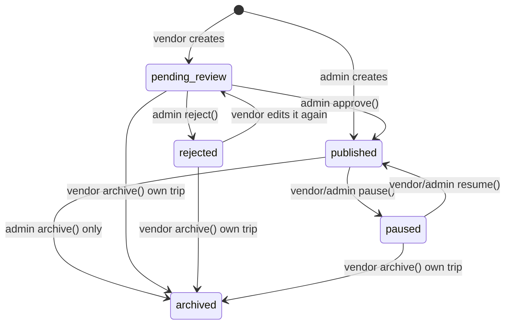
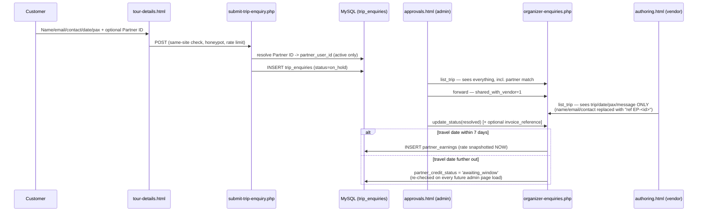
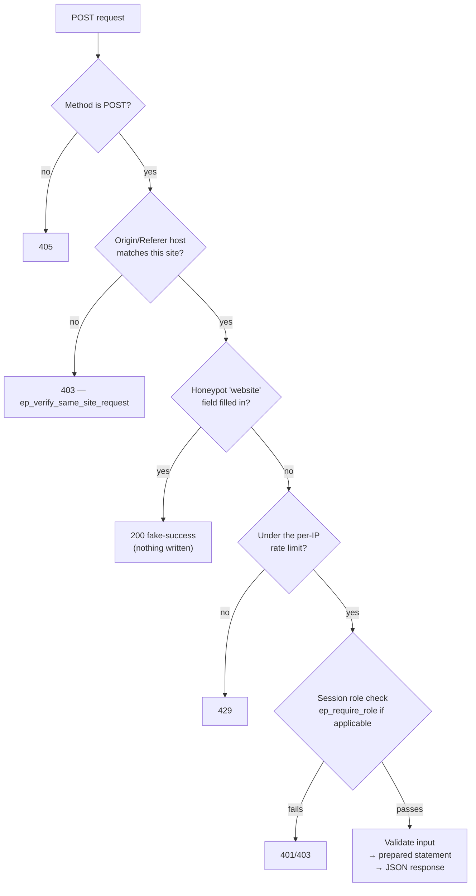

# Embark Pedia

Embark Pedia is a travel-booking marketing site for curated group journeys:
admin-run multi-day **ROAMS** (9–11 days) and vendor/admin-run **TRIPS**
(2–9 days), with a public catalogue, a contact/enquiry pipeline, a
newsletter signup, customer accounts, and an **organizer portal**
(vendor / admin / partner) for authoring, approvals, enquiries, sales and
referral commissions.

It is static HTML/CSS/JS (no build step, no framework) with a thin,
hand-rolled **PHP 8 + MySQL** backend (`/backend/`) bolted on for forms,
accounts and the organizer portal. **ROAMS and TRIPS are deliberately built
on two different architectures, not a historical accident** — see §4.1:
- **ROAMS are always hand-fed from static JS** (`assets/data/roams/`) —
  no database table, no backend endpoint, and none needed. Publishing a new
  ROAM (a "trip" in content-team terms) means replacing one JS file.
- **TRIPS, accounts, enquiries, sales and everything else organizer-run**
  are dynamic, DB-backed data queried through `/backend/`. The public
  catalogue for TRIPS works with zero backend at all (a hand-authored JS
  fallback) and silently upgrades itself the moment the PHP/MySQL layer is
  present — nothing about the static pages has to change.

This document is a from-scratch, code-level audit of the archive as it
actually stands today (not a changelog of what was *asked for*). It covers
how the pieces fit together, how data actually moves end-to-end, a security
review with concrete findings, an improvements/pending-work backlog, and a
go/no-go production-readiness checklist.

> **Companion documents**, all under [`database/`](database/) (and blocked
> from public access by `.htaccess` — see §8):
> - [`database/README.md`](database/README.md) — the original schema audit
>   and implementation-status changelog. **Known to be partly stale** — see
>   §7.5.
> - [`database/README_DB.md`](database/README_DB.md) — database
>   architecture reference: ERD-style domain guide, status lifecycles.
> - [`database/DB_Research.txt`](database/DB_Research.txt) — plain-language,
>   table-by-table walkthrough of why each table exists.
> - [`database/roam-details-fields.txt`](database/roam-details-fields.txt) —
>   the full field contract for a ROAM's `assets/data/roams/roam-<slug>.js`
>   file (not a database contract — ROAMS have no database table; see §4.1).
>
> None of these database docs describe ROAMS any more except as removed/
> historical context — ROAMS left the database entirely in this revision.

---

## Table of contents

1. [Tech stack](#1-tech-stack)
2. [Project structure](#2-project-structure)
3. [How a page is assembled](#3-how-a-page-is-assembled)
4. [Data flow](#4-data-flow)
5. [The organizer portal](#5-the-organizer-portal)
6. [Security — what's already in place, and what isn't](#6-security)
7. [Improvements, references & pending work](#7-improvements-references--pending-work)
8. [Production-readiness audit](#8-production-readiness-audit)
9. [Local setup](#9-local-setup)
10. [Where to go next](#10-where-to-go-next)

---

## 1. Tech stack

| Layer | Technology |
|---|---|
| Markup/styling | Static HTML5, hand-written CSS (no Sass/build step), Bootstrap 5 bundle (layout/grid utilities only) |
| Fonts | Google Fonts: **Cinzel Decorative** (headings), **Aleo** (body), **Podkova** (nav/buttons/labels) |
| Icons | Font Awesome (self-hosted in `assets/webfonts/`) + hand-drawn inline SVG |
| Client JS | Vanilla ES5-leaning JavaScript, no framework, no bundler |
| Server | PHP 8.x, procedural, one shared bootstrap (`backend/db.php`) — **23 endpoint files, all under `/backend/`** |
| Database | MySQL 8.0+ / MariaDB 10.5+, InnoDB, `utf8mb4` — **16 tables** (`database/schema.sql`), covering accounts, TRIPS, enquiries and sales only — **ROAMS are not in the database at all** (§4.1) |
| Web server | Apache with `mod_rewrite`, `mod_headers`, `mod_expires` (`.htaccess`) |

**No package.json, no npm, no composer.json, no webpack/vite.** Every
JS/CSS/font file is committed directly. `assets/js/bootstrap.bundle.min.js`
is the only vendored JS bundle. This is a deliberate choice (zero build
tooling, trivial to host anywhere PHP+MySQL exists) but it also means there
is no dependency manager to run `npm audit` / `composer audit` against —
see §7.4.

---

## 2. Project structure

```
.
├── .htaccess                     Apache config: error pages, HTTPS redirect,
│                                  security headers, cache headers, file hiding
├── 402.html / 404.html / 5xx.html  Brand-styled static error pages
├── index.html                    Home page
│
├── about/about.html               About Us
├── contact/contact.html           Contact Us (form → backend/connect.php)
├── auth/                          Customer login/signup (login.html, change-password.html)
├── account/                       Customer self-service profile (profile.html)
│
├── destinations/                  TRIPS catalogue (vendor/admin-authored, 2–9 days,
│   │                               dynamic/DB-backed — see §4.1)
│   ├── destination-list.html
│   ├── destination-tours.html     (?destination=<slug>)
│   └── tour-details.html          One TRIP + enquiry form (?article=<articleId>)
│
├── roams/                         ROAMS catalogue (hand-authored, 9–11 days,
│   │                               static JS only, no backend — see §4.1)
│   ├── roams.html
│   └── roam-list/roam.html        One ROAM's detail page (?slug=<slug>)
│
├── support/                       FAQs, Terms, Privacy, Cancellation Policy
│
├── organizer/                     Vendor / Admin / Partner portal (see §5) — TRIPS,
│   │                               accounts, enquiries, sales only; no ROAMS section
│   └── login.html  authoring.html  approvals.html  partner.html
│
├── assets/
│   ├── css/                       One stylesheet per page family, INCLUDING
│   │                               auth.css / account.css / organizer.css
│   │                               (moved here from their own folders)
│   ├── js/                        Every CLIENT-side script, nothing else —
│   │                               INCLUDING auth.js / profile.js / organizer.js
│   │                               (moved here from their own folders).
│   │                               No PHP lives under assets/ any more.
│   ├── data/roams/                ROAMS' entire live content — hand-authored,
│   │   ├── roams-index.js          no database, no backend. See §4.1.
│   │   ├── roam-arabisya-indino.js        ← one file per ROAM, wholesale-
│   │   ├── roam-coromandel-crest.js         replaced on any content change
│   │   └── roam-goanique-ganeshika.js
│   ├── include/header.html,footer.html   Canonical header/footer (hand-copied per page)
│   ├── favicon/, webfonts/, fonts/, images/   Static assets (~18 MB, see §7.2)
│
├── backend/                       EVERY PHP endpoint lives here now (23 files) —
│   │                               nothing but PHP; moved out of assets/js/ so
│   │                               server logic and client assets aren't mixed.
│   │                               No roams/public-roams.php or organizer-roams.php —
│   │                               see §4.1.
│   ├── db.php                      Shared bootstrap (config load, mysqli, helpers)
│   ├── config.sample.php           Template for config.php (never committed)
│   ├── login.php  signup.php  logout.php  forgot-password.php
│   │     change-password.php  customer-profile.php  me.php
│   ├── connect.php  subscribe.php  submit-trip-enquiry.php  public-trips.php
│   ├── vendor-signup.php
│   └── organizer-login.php  organizer-me.php  organizer-profile.php
│         organizer-trips.php  organizer-vendors.php  organizer-partners.php
│         organizer-enquiries.php  organizer-sales.php  partner-dashboard.php
│
├── database/                      schema.sql + the four docs listed above
│                                   (blocked from public access by .htaccess)
│
└── tools/                         Maintenance scripts, not part of the live site
    ├── check_chrome_sync.py        Diffs each page's inline header/footer copy
    └── localize_external_images.py Downloads Unsplash placeholders to local files
```

---

## 3. How a page is assembled

There's no templating engine, so the header and footer
(`assets/include/header.html` / `footer.html`) are **hand-copied inline**
into every page, with `../` path depth adjusted per page.
`tools/check_chrome_sync.py` is a drift-checker (not an auto-fixer) that
flags a page whose inline copy has diverged from the canonical one. This is
a real maintenance risk at this project's current size (24 HTML pages) and
will get worse as pages are added — see §7.3.

Every page loads, in order: `fontawesome.css` → `bootstrap.min.css` →
`style.css` → `responsive.css` → `header-footer.css` → **one page-family
stylesheet**. Brand tokens (fonts + 4-color palette) are declared
identically in `style.css` and `header-footer.css` on purpose, so the
header/footer still render correctly on a page that doesn't load
`style.css` for some reason.

```css
--f-heading: "Cinzel Decorative", serif;
--f-body:    "Aleo", serif;
--f-accent:  "Podkova", serif;

--color-primary:    #E91E63;   /* pink */
--color-secondary-1:#FDF6F0;   /* cream */
--color-secondary-2:#9CCC65;   /* green */
--color-accent:     #4A2C3A;   /* plum */
```

---

## 4. Data flow

### 4.1 ROAMS vs. TRIPS: two different architectures, by design

This is the single most important architectural fact about the codebase,
and it's a deliberate split, not an inconsistency: **ROAMS and TRIPS are
built on two entirely different data models**, chosen per-product because
they fit how each one is actually authored and how often it changes.

**ROAMS — always hand-fed from static JS. No database table. No backend
endpoint. None needed.**

A ROAM (the ~9–11 day, hand-authored flagship itinerary) is a handful of
items a year, written by a person, as rich long-form content (hero copy,
gallery, day-by-day itinerary, FAQ, etc.) — not a high-volume, frequently
mutated record that benefits from a database. So it isn't one:

- `assets/data/roams/roams-index.js` — the lightweight manifest (title,
  route, dates, thumbnail, blurb) that drives the roams.html card grid and
  the nav dropdown.
- `assets/data/roams/roam-<slug>.js` — **one file per ROAM**, the full
  detail-page content, loaded by `roam.html` straight off its own `?slug=`
  URL parameter. Publishing a new ROAM means adding one such file (named
  for its slug) plus one line in `roams-index.js`. Updating an existing
  ROAM's content means **replacing its one file wholesale** — no shared
  file to edit carefully around other ROAMS' content, no migration, no
  admin UI, no backend involved at any point. See that index file's own
  header comment for the full add/update/retire workflow, and
  [`database/roam-details-fields.txt`](database/roam-details-fields.txt)
  for the exact field contract each `roam-<slug>.js` file follows.

This was already closer to how ROAMS actually worked before this revision
than it first appears: the old `organizer-roams.php` endpoint had its
`create`/`update` actions permanently disabled, so a new ROAM was already
always being added by a human with direct access, by hand — just into
database rows instead of a file. Moving that hand-editing from SQL to JS
is a more honest match for the real workflow, and removes an entire
database/backend dependency for a part of the product that never actually
needed one.

**TRIPS, accounts, enquiries, sales — dynamic, DB-backed, via `/backend/`.**

Everything else — TRIPS (the vendor/admin-run, 2–9 day product), customer
accounts, the organizer portal, enquiries, and sales — really is dynamic
data: created and edited by multiple different people (vendors, admins)
through live forms, at a volume and mutation rate where a database is the
right tool. The public TRIPS catalogue reflects this with a **two-source
merge in the browser**, so the site works with zero backend and only gets
better once a database is attached — it never breaks without one:

- `assets/js/datasets.js` (`DESTINATIONS_DATA`) — hand-authored, always
  present, the fallback/seed source.
- `backend/public-trips.php` — an unauthenticated `GET` endpoint that
  returns only `status='published'` rows from MySQL, in the same shape the
  static file uses.


A TRIP only ever becomes publicly visible once its `status` column reaches
`published` — every other status (`draft`, `pending_review`, `paused`,
`rejected`, `archived`) is invisible to this endpoint, regardless of what
`datasets.js` says. This is the actual authorization boundary for "what
the public can see," and it's enforced in SQL (`WHERE status =
'published'`), not just in the UI. ROAMS have no equivalent status/boundary
at all — a ROAM is visible the moment its file exists and is listed in
`roams-index.js`, exactly as "visible" as any other static page on the
site.

### 4.2 TRIP (tour) lifecycle



Key rule enforced in `organizer-trips.php`: once a trip is `published`, a
vendor can no longer edit its fields (`ep_trip_owned_editable()`) — only an
admin can. A vendor *can* still pause/resume/archive their own published
trip (deliberately **not** gated by that same helper — see the inline
comment in the file). **ROAMS have no lifecycle like this at all, and no
organizer-portal page for it** — see §4.1. There is no `organizer-roams.php`
any more, and no `roams` table for it to operate on; a ROAM's "lifecycle" is
simply whether its file exists and is listed in `roams-index.js`.

### 4.3 Enquiry → forwarding → partner commission



Two design points worth calling out explicitly:

- **PII minimization by design**: a vendor never sees the customer's name,
  email or phone number for a trip enquiry, even after it's forwarded — the
  admin stays the sole point of customer contact. This is enforced in the
  SQL the vendor's view runs (the columns simply aren't selected), not
  just hidden in the UI.
- **Commission rates are snapshotted, never retroactive**: `partner_earnings
  .profit_share_percent_applied` freezes the rate at the moment of credit.
  Changing a partner's live rate (`organizer-partners.php`'s
  `update_tier`) only affects referrals credited *after* the change.
- **There is no scheduler in this stack.** The "7-day window" rule is
  re-evaluated every time an admin loads the trip-enquiries list
  (`ep_recheck_all_pending_partner_credits()`), or on demand via a "Check
  due credits" button. If the admin dashboard goes untouched for a long
  stretch, a due credit will not appear until someone next loads that page
  — see §7.1 for the recommended fix (a real cron/queue).

### 4.4 Request pipeline every stateful PHP endpoint follows



This pipeline is consistent across all 16 state-changing endpoints in
`/backend/` (`login.php`, `signup.php`, `vendor-signup.php`, `connect.php`,
`subscribe.php`, `submit-trip-enquiry.php`, `forgot-password.php`,
`change-password.php`, and all eight `organizer-*.php` files — there is no
`organizer-roams.php` any more, see §4.1). The one unauthenticated read-only
`GET` endpoint (`public-trips.php`) skips the same-site/honeypot/rate-limit
steps since it doesn't mutate anything or require a session — see §6.3
(M-7) for a caveat. (There is no `public-roams.php` either — ROAMS have no
backend endpoint of any kind.)

---

## 5. The organizer portal

| Page | Who | What it does |
|---|---|---|
| `login.html` | vendor, partner, admin | Tabbed sign-in; vendor can also sign up here (→ `pending` review) |
| `authoring.html` | vendor, admin | Create/edit TRIPS, manage inclusions/exclusions/itinerary/stays, pause/resume, log a sale (trip or, by free-text name, a ROAM — see §4.1) against their own trips |
| `approvals.html` | admin only | Approve/reject/suspend vendors & vendor trips, forward/resolve enquiries, manage partners, run quarterly payouts |
| `partner.html` | partner, vendor | Referral dashboard: PartnerID, commission tier, pending vs. paid earnings |

There is no ROAMS section anywhere in this portal any more — ROAMS have
nothing for an admin to approve, pause, or toggle (§4.1). A previous
revision had a ROAMS visibility toggle in `authoring.html`; it's gone, along
with the `organizer-roams.php` endpoint it called.

Every `organizer-*.php` endpoint calls `ep_require_role([...])` **first**,
before touching any data — this is the single authorization choke point for
the whole portal, and every one of the eight files was verified in this
audit to call it correctly. `organizer.js` also re-checks the session via
`organizer-me.php` on every page load as a client-side guard, so a vendor
can't land on the admin shell by guessing a URL (though that client-side
check is UX only — the real boundary is server-side, as it should be).

### Demo mode: `mock-backend.js`

All organizer pages (plus several public pages — see §6.1's note) currently
load `assets/js/mock-backend.js` **before** `organizer.js`. It patches
`window.fetch` so every `organizer-*.php`/`login`/`logout` request is
answered from an in-memory store (persisted to `localStorage`) instead of
hitting a real server — the entire portal can be clicked through with no
PHP, no MySQL, no network, using seeded trial logins documented in the
file's header comment. (There is no mock for ROAMS any more — nothing to
mock, since there's no `organizer-roams.php` to intercept in the first
place.)

**Correction found in this audit:** earlier revisions of this document said
`mock-backend.js` loads on "all four organizer pages." Checking every page
directly shows it's actually loaded on effectively every page on the
site — the four organizer pages, `index.html`, `auth/`, `account/`,
`contact/`, `roams/`, `destinations/`, `support/` and `about/` all include
it, almost certainly so the shared header/footer chrome (nav login state,
etc.) behaves consistently in a no-backend preview everywhere, not just in
the portal.

**This must be removed before deployment** — delete the `mock-backend.js`
`<script>` tag from every page that has one (search the repo for
`mock-backend.js` to find them all; don't assume it's only the four
organizer pages). Nothing else needs to change, since `organizer.js` and
`chrome.js` talk to the same relative endpoint paths either way. See §8
item B-9.

---

## 6. Security

### 6.1 What's already implemented (verified by reading the code, not just the comments)

- **Password storage**: `password_hash()` (bcrypt, cost 12) plus a
  server-side "pepper" (`EMBARKPEDIA_PASSWORD_PEPPER`) never stored in the
  database — a stolen `users` table alone isn't enough to brute-force
  passwords.
- **Account lockout**: 5 failed logins locks an account for 15 minutes
  (`users.failed_attempts`/`locked_until`), independent of the IP-based
  limit below. Verified present identically in both `login.php` and
  `organizer-login.php`.
- **Rate limiting**: every public POST endpoint calls `ep_rate_limit()`
  (database-backed — works on any shared host, no Redis/APCu needed).
- **CSRF baseline**: `ep_verify_same_site_request()` checks Origin/Referer
  against the request's own Host on every state-changing endpoint except
  `logout.php` (see M-5 below) — a pragmatic baseline given there's no
  templating layer to embed a synchronizer token in, not a full
  double-submit scheme (the code says so itself).
- **Honeypot**: every public form has a hidden `website` field; a filled-in
  value is treated as a bot and silently no-ops with a fake success
  response.
- **Session hardening**: `HttpOnly`, `SameSite=Lax`, `Secure` in production,
  custom session name, `session_regenerate_id()` on every login/signup
  (mitigates session fixation).
- **SQL injection**: every endpoint that accepts free-text or
  attacker-influenced input uses `mysqli` prepared statements with bound
  parameters. A number of internal `$conn->query()` calls interpolate PHP
  variables directly into SQL strings instead of binding them — **every
  single one of these was traced in this audit and confirmed to carry only
  values already cast with `(int)` or sourced from `$stmt->insert_id`**, so
  there is no live SQL-injection vector today. This pattern is still flagged
  as a maintainability risk — see M-6.
- **Stored XSS**: client-side rendering (`organizer.js`, `tour-render.js`,
  `roam-render.js`, `testimony-*.js`) consistently routes
  server-/user-supplied strings through a shared `esc()` HTML-escaping
  helper before building `innerHTML`. Spot-checked across enquiry rows,
  contact messages, trip titles, partner names and sales records — escaping
  was present in every case reviewed.
- **Account enumeration resistance**: `login.php`, `signup.php`,
  `vendor-signup.php` and `forgot-password.php` all return the same generic
  message whether an email exists or not.
- **PII-aware enquiry forwarding**: see §4.3 — a vendor never receives a
  customer's name/email/phone, only a reference code.
- **Transactional integrity**: every multi-table write (trip create/update
  with children, vendor+profile signup, partner onboarding, payout runs)
  is wrapped in `begin_transaction()`/`commit()`/`rollback()`.
- **Security headers** (`.htaccess`): `X-Content-Type-Options: nosniff`,
  `X-Frame-Options: SAMEORIGIN`, a restrictive `Permissions-Policy`, and a
  `Content-Security-Policy-Report-Only` header (see H-2 below for why this
  needs work before it's actually protective).
- **File hiding**: `.env`, `.git*`, `*.md`, `*.txt`, `*.sql`,
  `backend/config(.sample).php` specifically, `*.bak`, `*.zip`, and the
  whole `/database/` and `/tools/` directories are denied by `.htaccess`.
  The rest of `/backend/` is deliberately **not** blocked wholesale — its
  `*.php` files are the live endpoints the site's own JS calls by design;
  only the config file itself (which holds no output of its own, but is
  blocked anyway as defense in depth) is singled out.

### 6.2 Findings & recommendations

Ordered by severity. **C** = must fix before any production traffic. **H**
= fix before launch. **M** = fix soon after launch. **L** = low-priority
hardening.

| # | Severity | Finding | Recommendation |
|---|---|---|---|
| **C-1** | Critical | `connect.php`'s own header comment states plainly: *"credentials that were hardcoded in an earlier copy of this file were exposed publicly... rotate its password — replacing this file does not undo that exposure."* This means a real database password may already be compromised, independent of anything in the current code. | Treat this as an active incident, not a historical footnote: rotate the MySQL password and the `EMBARKPEDIA_PASSWORD_PEPPER` **before** this codebase ever touches a real database, confirm the exposed version is purged from any git history / backup / CDN cache, and audit that database's access logs if it was ever live. |
| **C-2** | Critical | Bot/abuse protection on signup and the trip-enquiry form is **entirely client-side and non-functional as shipped**: (a) the signup canvas captcha is drawn and checked only in `auth.js` — never re-verified server-side, so a direct POST to `signup.php` skips it completely; (b) `tour-render.js` hard-codes `RECAPTCHA_SITE_KEY` to **Google's published, publicly-documented *test* key**, which always validates regardless of input and provides literally zero protection. | Before launch: integrate a real reCAPTCHA v3/hCaptcha/Turnstile site key **and** verify the token server-side in the corresponding PHP endpoint (`signup.php`, `submit-trip-enquiry.php`) before accepting the submission. Until this is done, rely only on the honeypot + rate limiter, which are real but modest. |
| **H-1** | High | No `.gitignore` exists anywhere in the archive, despite `config.sample.php`'s own instructions assuming one (`backend/config.php` is where real DB credentials would live). One `git add .` away from reproducing C-1. | Add a `.gitignore` excluding `backend/config.php`, `*.bak`, local env files, and OS/editor cruft, before this project is ever pushed to a repository. |
| **H-2** | High | The CSP is `Report-Only` **and** very permissive: `script-src 'self' 'unsafe-inline' https:` allows *any* HTTPS-hosted script plus all inline `<script>` blocks. As written, flipping `Content-Security-Policy-Report-Only` to `Content-Security-Policy` would add negligible real XSS protection. | Tighten `script-src`/`style-src` to an explicit allow-list (the four CDN hosts actually used, Google Fonts) or move to nonces/hashes for the inline scripts, monitor reports for a deploy cycle, then flip to enforcing. |
| **H-3** | High | No `Strict-Transport-Security` header is set, even though `.htaccess` already force-redirects to HTTPS. Without HSTS, the first request (or any request through a misconfigured proxy/stripped TLS) is vulnerable to downgrade. | Add `Header always set Strict-Transport-Security "max-age=63072000; includeSubDomains; preload"` once HTTPS is confirmed stable in production, and consider HSTS preload-list submission. |
| **H-4** | High | No transactional email provider is wired up anywhere. `ep_send_mail()` falls back to PHP's bare `mail()` in production (commonly spam-foldered/blocked by receiving MTAs with no SPF/DKIM/DMARC behind it) and to `error_log()` in development. This directly affects password-reset delivery, a basic account-security feature, not just the newsletter. | Integrate a real provider (SES, SendGrid, Postmark, etc.) with a verified sending domain, SPF, DKIM and DMARC configured, before launch. |
| **H-5** | High | No email verification exists at signup for any account type — anyone can register (and later request password resets for) an email address they don't own. Combine with H-4 and this becomes a real account-takeover/abuse surface once mail is reliably delivered. | Add an email-verification step (token + confirmation link) at signup, gating at minimum any flow that emails a secret (password reset) until the address is confirmed. |
| **M-1** | Medium | `rate_limits` has no scheduled cleanup — the retention `DELETE` is only left as a comment in `schema.sql`, never wired to a cron. | Add a daily cron (or a lightweight probabilistic cleanup on write) running `DELETE FROM rate_limits WHERE created_at < NOW() - INTERVAL 1 DAY`. |
| **M-2** | Medium | No MFA option for admin/vendor/partner accounts, which can run partner payouts, suspend other accounts, and view full customer PII. | Add TOTP-based 2FA, at minimum mandatory for `admin` accounts. |
| **L-2** | Low | No CDN/WAF sits in front of the application; all abuse control is purely application-level (DB-backed rate limiting). | Consider fronting production with a CDN/WAF (also solves the static-asset performance gap in §7.2). |
| **L-3** | Low | `mock-backend.js` and its trial credentials must not ship to production — see §5. It's referenced far more widely than just the organizer pages (see §5's correction note). | Remove every `<script src=".../mock-backend.js">` tag before deploy, not just the four organizer ones; consider a build-time check that fails if this file is referenced outside a `dev`/`demo` flag. |

### 6.3 Additional notes (not a ranked "fix this" item, but worth recording)

- **M-7**: `public-trips.php` has no rate limiting or caching beyond the
  browser `mod_expires` rules — fine at current scale, but since its
  output only changes when an organizer edits a listing, it's an excellent
  candidate for a short server-side cache (even a flat JSON file
  regenerated on publish/pause/archive) once traffic grows. (This doesn't
  apply to ROAMS — there's no endpoint to cache; `assets/data/roams/` is
  already as static as a cache gets.)
- The `partner_earnings.profit_share_percent` `CHECK` constraint
  (30–50%) and the trip's 2–9 day `CHECK` constraint are both enforced
  **in two places** — the database `CHECK` and the PHP validation — which
  is good defense in depth, not a gap.
- No file-upload functionality exists anywhere in the current codebase
  (every image is a pasted URL) — this avoids an entire class of upload
  vulnerabilities today, but means if/when file upload is added (e.g. for
  vendor-submitted trip photos), it needs its own dedicated security review
  (MIME sniffing, size limits, re-encoding, storage outside the web root).

---

## 7. Improvements, references & pending work

### 7.1 Product / data gaps (already called out in `database/schema.sql` §7)

- No `bookings`/`payments` table — `sales` is a manually-logged ledger, not
  a checkout flow. There is no payment gateway anywhere in this project.
- No `password_resets`/`email_verification` tables — see H-5 above.
- Testimonials/reviews are hardcoded in `assets/js/testimony.js`, not
  database-backed.
- The 7-day partner-commission window is re-checked **on page load only**
  (§4.3) — there is no actual job scheduler in this stack. A real deploy
  should add a cron hitting `organizer-enquiries.php`'s
  `recheck_partner_credits` action (or an equivalent script) on a fixed
  schedule, independent of admin activity.
- Newsletter double opt-in is half-built: `subscribe.php` stores an
  unconfirmed row and a confirmation token, but nothing sends the
  confirmation email or consumes the token (depends on H-4). **Do not bulk
  email the `newsletter_subscribers` table as-is — every row is
  unconfirmed.**

### 7.2 Performance

- `assets/images/` is ~18 MB of largely unoptimized originals — several
  PNG/JPG files are 600–750 KB each (`testimony-3.png` at 750 KB,
  `hero-1.jpg`/`hero-2.jpg` at ~700 KB). No WebP/AVIF variants exist, no
  `srcset`/responsive images, and no `loading="lazy"` attributes anywhere
  in the scanned pages. On a travel site where hero/gallery imagery is the
  main content, this is a direct hit to LCP and overall page weight.
  Recommend: compress + convert to WebP with JPEG fallback, add `srcset`
  for at least hero/card images, and add `loading="lazy"` to
  below-the-fold `` tags.
- No CDN in front of static assets — `.htaccess`'s `mod_expires` only
  controls *browser* cache (7–30 days), not origin offload.
- No `preconnect`/`preload` resource hints for the Google Fonts or Font
  Awesome requests every page makes.

### 7.3 SEO, discoverability & observability

- No `robots.txt` or `sitemap.xml` at the project root.
- No Open Graph / Twitter Card meta tags or canonical links spotted on the
  pages scanned (only a basic `<meta name="description">` and `<title>`)
  — worth a full per-page pass for a marketing site that will be shared on
  social platforms.
- No structured data (JSON-LD) for travel products — would help rich
  results for TRIP/ROAM listings.
- No analytics (no Google Analytics/GTM or any alternative) anywhere in
  the codebase — there is currently no way to measure the
  enquiry/signup/sales funnel this product exists to drive, nor any
  real-user performance monitoring.
- No centralized logging/alerting beyond PHP's own `error_log()` — nothing
  surfaces a spike in failed logins, rate-limit hits, or 500s.
- `tools/check_chrome_sync.py` is a drift *detector*, not an auto-fixer,
  for the hand-copied header/footer markup across 24 HTML pages — this
  gap will scale worse as more pages are added, and is the strongest
  argument in the codebase for eventually adopting even a minimal static
  site generator or include mechanism (while keeping the "no framework"
  philosophy for the rendered output).

### 7.4 Testing & tooling

- No automated test suite exists (no PHPUnit, no JS test runner, no CI
  config). `database/README.md` documents one manual walkthrough against a
  local MariaDB instance — useful, but a regression in e.g.
  `ep_require_role()` or a status-lifecycle rule would not be caught
  automatically today.
- No `composer.json` — fine given there are no third-party PHP
  dependencies, but it also means the PHP version/extension requirements
  (`mysqli`, `mbstring`, JSON) are only documented in prose, not
  enforceable by tooling.
- No `.gitignore` — see H-1.

### 7.5 Documentation references that need cleanup

- ~~`database/README.md` line ~60 still describes the trip-enquiry form as
  posting into `contact_messages` via `connect.php`~~ — **resolved in this
  revision.** `database/README.md` now carries its own correction note
  (at the top of the file) pointing out that `submit-trip-enquiry.php`
  writes directly into `trip_enquiries`, instead of relying on a pointer
  in a sibling file as before.
- ~~`database/README.md` describes ROAMS as having listing-level CRUD in
  `organizer-roams.php`~~ — **resolved in this revision**, and then some:
  that description was already stale before this pass (the endpoint's
  `create`/`update` actions had been disabled), and is now further
  overtaken by ROAMS leaving the database entirely (§4.1). All four
  `database/` docs were updated together in this revision to describe the
  new architecture consistently rather than independently drifting.
- Several PHP file comments reference a `Final_Changes.txt` file (e.g., as
  the record of what was tested against a local MariaDB instance) that
  **does not exist anywhere in this archive**. Either that file was never
  included, or the reference is stale — resolve one way or the other so
  the comment isn't pointing at a dead link.
- `database/README.md`'s own "Install and production cautions" section
  independently arrives at several of the same findings as §6/§8 here
  (least-privilege DB grants, pepper rotation, newsletter confirmation,
  retention policy) — the two documents should be reconciled so there's
  one authoritative pre-launch checklist instead of two overlapping ones.

---

## 8. Production-readiness audit

**Verdict: not production-ready as-is.** The application layer is unusually
careful for a hand-rolled PHP project (see §6.1), but there are two
Critical and five High findings above that are launch-blocking, plus the
infrastructure/process items below that have no code to point to because
they simply haven't been done yet.

### Blocking (must complete before any real traffic or real data)

- [ ] **B-1** Rotate the database password and `EMBARKPEDIA_PASSWORD_PEPPER`
      referenced in C-1; confirm no exposed credential is reachable via git
      history, backups, or caches.
- [ ] **B-2** Wire real, server-verified bot protection (C-2): a real
      reCAPTCHA/hCaptcha/Turnstile site key **and** server-side token
      verification on `signup.php` and `submit-trip-enquiry.php`.
- [ ] **B-3** Add `.gitignore` excluding `backend/config.php` and other
      local/secret files (H-1), *before* the project is committed anywhere.
- [ ] **B-4** Generate a fresh, random `EMBARKPEDIA_PASSWORD_PEPPER`
      (`php -r "echo bin2hex(random_bytes(32));"`) per environment, stored
      outside source control (env var, not `config.php`, on anything
      shared).
- [ ] **B-5** Create a dedicated, least-privilege MySQL application user —
      `SELECT`/`INSERT`/`UPDATE`/`DELETE` only, no `DROP`/`ALTER`/`GRANT`
      (`database/README.md` already specifies the exact grant pattern used
      in its own test run).
- [ ] **B-6** Load `database/schema.sql` against a fresh database and seed
      the first admin account per the instructions at the end of that
      file; change its password via the organizer profile page immediately
      after first login.
- [ ] **B-7** Wire a real transactional email provider with a verified
      sending domain + SPF/DKIM/DMARC (H-4) — password reset is not
      optional for launch.
- [ ] **B-8** Set `EMBARKPEDIA_APP_ENV=production` (never leave it on
      `development`, which disables the `Secure` cookie flag and exposes
      PHP errors).
- [ ] **B-9** Remove every `mock-backend.js` `<script>` tag — it's on
      effectively every page, not just the four `/organizer/` ones (§5,
      L-3).
- [ ] **B-10** Confirm Apache is actually running with `mod_rewrite`,
      `mod_headers` and `mod_expires` enabled — `.htaccess` silently does
      nothing for the directives inside a disabled `<IfModule>` block.
- [ ] **B-11** Decide and document a data-retention/deletion policy for
      enquiries, accounts and vendor registration details (collects age,
      gender, phone, email) before accepting real customer data — this is
      a legal/compliance item, not just an engineering one.
- [ ] **B-12** Put a tested (not just configured) database backup +
      restore process in place. (The 90-day-primary / 2-year-archive
      *retention* policy is now in place — `tools/retention-cleanup.php`
      — but that's a separate concern from a full disaster-recovery
      backup/restore drill, which is still outstanding.)

### Should fix soon after launch

- [ ] Tighten and enforce the CSP (H-2); add HSTS (H-3).
- [ ] Add email verification at signup (H-5).
- [ ] Schedule `rate_limits` cleanup (M-1).
- [ ] Add 2FA for admin accounts at minimum (M-2).
- [ ] Add a real cron for the partner-commission 7-day-window recheck
      (§7.1) instead of relying on admin page-load timing.
- [ ] Compress/convert the image library and add lazy-loading + `srcset`
      (§7.2) — directly affects conversion rate on a marketing site.
- [ ] Add `robots.txt`, `sitemap.xml`, Open Graph tags, and basic analytics
      (§7.3) so launch performance can actually be measured.
- [ ] Reconcile `database/README.md` with the current code (§7.5) and
      remove or fix the dangling `Final_Changes.txt` references.

### Infrastructure checklist (standard, but worth stating explicitly)

- [ ] TLS certificate installed and auto-renewing; HTTPS redirect (already
      in `.htaccess`) verified end-to-end through any reverse proxy/CDN.
- [ ] PHP 8.x with the `mysqli`, `mbstring` and JSON extensions enabled;
      `display_errors=Off` in the real `php.ini`, not just `db.php`'s own
      `ini_set()` call (belt-and-suspenders, since a parse error before
      `db.php` even loads would otherwise leak).
- [ ] MySQL 8.0+/MariaDB 10.5+ provisioned with daily automated backups and
      a tested restore runbook.
- [ ] Monitoring/alerting on 5xx rate, failed-login spikes, and rate-limit
      429s (none exists today — see §7.3).
- [ ] A staging environment that mirrors production for testing schema
      migrations before they touch real data (`schema.sql` is a
      fresh-install file, not a migration tool — see its own header
      comment).

---

## 9. Local setup

1. **Static-only preview** (no backend): open `index.html` directly, or
   serve the folder with any static file server. The ROAMS catalogue works
   fully and identically either way — it never needed a backend (§4.1). The
   TRIPS catalogue works from `datasets.js` alone; forms will fail to
   submit (no PHP); the organizer portal works fully via `mock-backend.js`
   (§5) — **for local development only, never in production (B-9)**.
2. **Full stack** (PHP + MySQL):
   ```bash
   cp backend/config.sample.php backend/config.php   # then fill it in,
   # or set the EMBARKPEDIA_DB_* / EMBARKPEDIA_PASSWORD_PEPPER env vars instead
   mysql -u DB_ADMIN -p your_database_name < database/schema.sql
   php -S localhost:8000   # from the project root
   ```
   Seed an admin account per the instructions at the end of
   `database/schema.sql`, and remove every `mock-backend.js` `<script>` tag
   (not just the four `/organizer/` pages — see §5's correction note) once
   you want the whole site to hit the real endpoints. This step is about
   TRIPS/accounts/enquiries/sales only — ROAMS are unaffected either way,
   since they never read from the database.
3. Deploy behind Apache with `mod_rewrite`, `mod_headers`, and
   `mod_expires` enabled so `.htaccess` takes full effect, and work through
   §8 before pointing real traffic at it.

---

## 10. Where to go next

- Adding a destination/TRIP by hand, as a static fallback (no backend
  required, but TRIPS can also be fully backend-authored through
  `/organizer/`)? Edit `assets/js/datasets.js`.
- Adding a ROAM — this is **always** how it's done, there is no other way
  and no backend involved at all (§4.1): create
  `assets/data/roams/roam-<slug>.js` following
  [`database/roam-details-fields.txt`](database/roam-details-fields.txt),
  then add one entry to `assets/data/roams/roams-index.js`. See that
  index file's own header comment for the full add/update/retire
  workflow.
- Understanding or changing the database? Start with
  [`database/README_DB.md`](database/README_DB.md), then
  [`database/DB_Research.txt`](database/DB_Research.txt), then
  `database/schema.sql` as the authoritative DDL.
- Working through the pre-launch checklist? Start at §8 above, and cross-
  reference `database/README.md`'s own "Install and production cautions"
  section (§7.5 notes where the two currently overlap).
