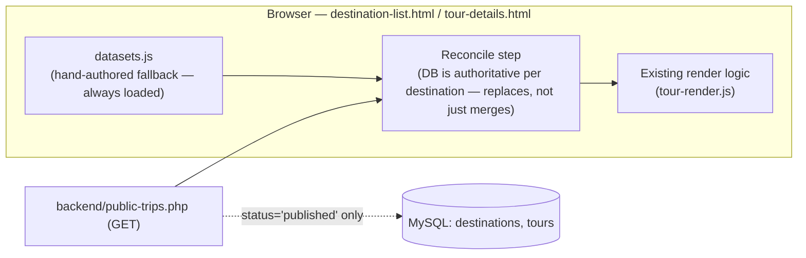
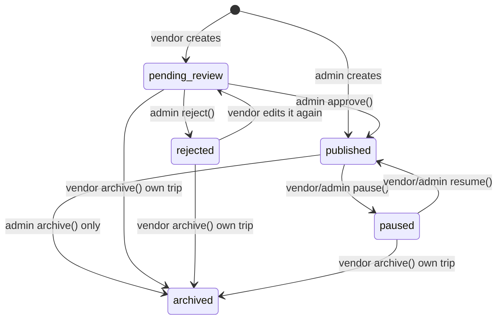
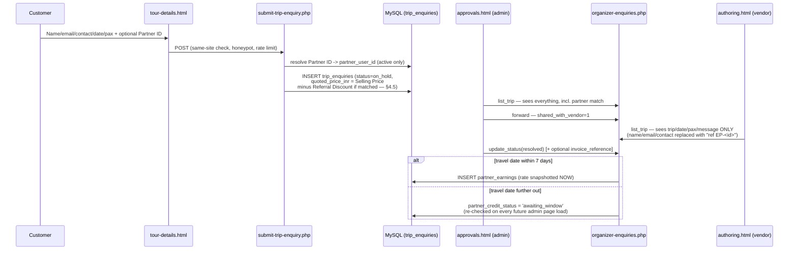
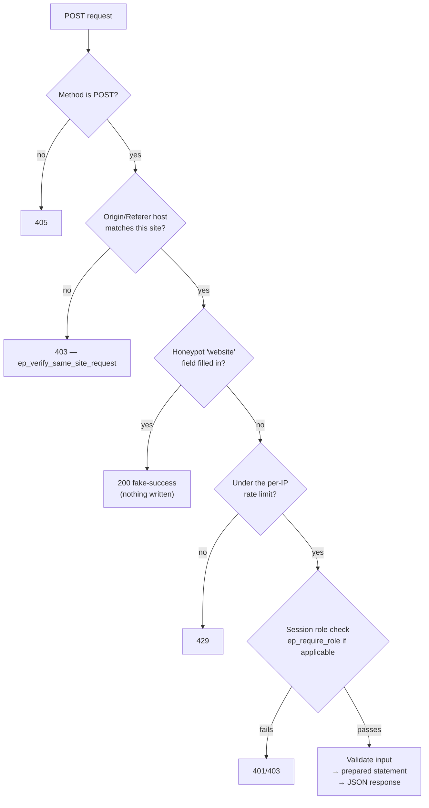

# Embark Pedia

Embark Pedia is a travel-booking marketing site for curated group journeys:
admin-run multi-day **ROAMS** (9–11 days) and vendor/admin-run **TRIPS**
(2–9 days), with a public catalogue, a contact/enquiry pipeline, a
newsletter signup, customer accounts, and an **organizer portal**
(vendor / admin / partner) for authoring, approvals, enquiries, sales and
referral commissions.

It is static HTML/CSS/JS (no build step, no framework) with a thin,
hand-rolled **PHP 8 + MySQL** backend (`/backend/`) bolted on for forms,
accounts and the organizer portal. **ROAMS and TRIPS are deliberately built
on two different architectures, not a historical accident** — see §4.1:
- **ROAMS are always hand-fed from static JS** (`assets/data/roams/`) —
  no database table, no backend endpoint, and none needed. Publishing a new
  ROAM (a "trip" in content-team terms) means replacing one JS file.
- **TRIPS, accounts, enquiries, sales and everything else organizer-run**
  are dynamic, DB-backed data queried through `/backend/`. The public
  catalogue for TRIPS works with zero backend at all (a hand-authored JS
  fallback) and silently upgrades itself the moment the PHP/MySQL layer is
  present — nothing about the static pages has to change.

This document is a from-scratch, code-level audit of the archive as it
actually stands today (not a changelog of what was *asked for*). It covers
how the pieces fit together, how data actually moves end-to-end, a security
review with concrete findings, an improvements/pending-work backlog, and a
go/no-go production-readiness checklist.

> **This revision re-verified every claim in the previous audit directly
> against the code** rather than carrying it forward, and found several
> places where the code had moved on without the document catching up —
> both improvements (a `.htaccess` now exists and is *stricter* than
> previously described) and new gaps (that stricter policy conflicts with
> code nobody checked against it, and no local copy of the images 20+ pages
> reference exists anywhere in this archive). See the correction callouts
> throughout (§6.2 H-2, §6.1, §7.2, §7.5) and the summary at the top of
> §8. Nothing here was taken on faith from the prior document.

> **Companion documents**, all under [`database/`](database/) (and blocked
> from public access by `.htaccess` — see §8):
> - [`database/README.md`](database/README.md) — the original schema audit
>   and implementation-status changelog. **Known to be partly stale** — see
>   §7.5.
> - [`database/README_DB.md`](database/README_DB.md) — database
>   architecture reference: ERD-style domain guide, status lifecycles.
> - [`database/DB_Research.txt`](database/DB_Research.txt) — plain-language,
>   table-by-table walkthrough of why each table exists.
> - [`database/roam-details-fields.txt`](database/roam-details-fields.txt) —
>   the full field contract for a ROAM's `assets/data/roams/roam-<slug>.js`
>   file (not a database contract — ROAMS have no database table; see §4.1).
>
> None of these database docs describe ROAMS any more except as removed/
> historical context — ROAMS left the database entirely in this revision.

---

## Table of contents

1. [Tech stack](#1-tech-stack)
2. [Project structure](#2-project-structure)
3. [How a page is assembled](#3-how-a-page-is-assembled)
4. [Data flow](#4-data-flow)
5. [The organizer portal](#5-the-organizer-portal)
6. [Security — what's already in place, and what isn't](#6-security)
7. [Improvements, references & pending work](#7-improvements-references--pending-work)
8. [Production-readiness audit](#8-production-readiness-audit)
9. [Local setup](#9-local-setup)
10. [Where to go next](#10-where-to-go-next)

---

## 1. Tech stack

| Layer | Technology |
|---|---|
| Markup/styling | Static HTML5, hand-written CSS (no Sass/build step), Bootstrap 5 bundle (layout/grid utilities only) |
| Fonts | Google Fonts: **Cinzel Decorative** (headings), **Aleo** (body), **Podkova** (nav/buttons/labels) — loaded via `@import` inside `style.css`/`header-footer.css`, not self-hosted (see §3, §7.2) |
| Icons | Font Awesome (self-hosted in `assets/webfonts/`) + hand-drawn inline SVG |
| Client JS | Vanilla ES5-leaning JavaScript, no framework, no bundler |
| Server | PHP 8.x, procedural, one shared bootstrap (`backend/db.php`) — **24 endpoint files, all under `/backend/`** |
| Database | MySQL 8.0+ / MariaDB 10.5+, InnoDB, `utf8mb4` — **17 tables** (`database/schema.sql`), covering accounts, TRIPS, enquiries and sales only, plus 3 `*_archive` tables for the retention policy (§7.1) — **ROAMS are not in the database at all** (§4.1) |
| Web server | Apache with `mod_rewrite`, `mod_headers`, `mod_expires` (`.htaccess`) |

**No package.json, no npm, no composer.json, no webpack/vite.** Every
JS/CSS/font file is committed directly. `assets/js/bootstrap.bundle.min.js`
is the only vendored JS bundle — confirmed by inspection of every file in
`assets/js/` (18 files total, 17 hand-written project scripts plus this one
bundle). This is a deliberate choice (zero build tooling, trivial to host
anywhere PHP+MySQL exists) but it also means there is no dependency manager
to run `npm audit` / `composer audit` against — see §7.4.

---

## 2. Project structure

```
.
├── .htaccess                     Apache config: error pages, HTTPS redirect,
│                                  security headers, cache headers, file hiding
├── 402.html / 404.html / 5xx.html  Brand-styled static error pages
├── index.html                    Home page
│
├── about/about.html               About Us
├── contact/contact.html           Contact Us (form → backend/connect.php)
├── auth/                          Customer login/signup (login.html, change-password.html)
├── account/                       Customer self-service profile (profile.html)
│
├── destinations/                  TRIPS catalogue (vendor/admin-authored, 2–9 days,
│   │                               dynamic/DB-backed — see §4.1)
│   ├── destination-list.html
│   ├── destination-tours.html     (?destination=<slug>)
│   └── tour-details.html          One TRIP + enquiry form (?article=<articleId>)
│
├── roams/                         ROAMS catalogue (hand-authored, 9–11 days,
│   │                               static JS only, no backend — see §4.1)
│   ├── roams.html
│   └── roam-list/roam.html        One ROAM's detail page (?slug=<slug>)
│
├── support/                       FAQs, Terms, Privacy, Cancellation Policy
│
├── organizer/                     Vendor / Admin / Partner portal (see §5) — TRIPS,
│   │                               accounts, enquiries, sales only; no ROAMS section
│   └── login.html  authoring.html  approvals.html  partner.html
│
├── assets/
│   ├── css/                       One stylesheet per page family, INCLUDING
│   │                               auth.css / account.css / organizer.css
│   │                               (moved here from their own folders)
│   ├── js/                        Every CLIENT-side script, nothing else —
│   │                               INCLUDING auth.js / profile.js / organizer.js
│   │                               (moved here from their own folders).
│   │                               No PHP lives under assets/ any more.
│   │                               NOTE: a stray `datasets.js.bak` sits
│   │                               alongside `datasets.js` — harmless (every
│   │                               `*.bak` file is blocked by `.htaccess`)
│   │                               but shouldn't be committed/shipped. See
│   │                               §6.2 L-1.
│   ├── data/roams/                ROAMS' entire live content — hand-authored,
│   │   ├── roams-index.js          no database, no backend. See §4.1.
│   │   ├── roam-arabisya-indino.js        ← one file per ROAM, wholesale-
│   │   ├── roam-coromandel-crest.js         replaced on any content change
│   │   └── roam-goanique-ganeshika.js
│   ├── include/header.html,footer.html   Canonical header/footer (hand-copied per page)
│   ├── favicon/, webfonts/   Static assets actually present (~470 KB combined)
│   ├── fonts/                     Present but EMPTY — fonts are pulled from
│   │                               Google's CDN via CSS `@import`, not from
│   │                               here (see §3, §7.2). Likely vestigial.
│   └── images/                     **Does not exist in this archive** — see
│                                    §7.2 and §8 (B-13) for why this matters:
│                                    the HTML/CSS reference 34 distinct paths
│                                    under this directory (logo, hero banners,
│                                    icons, client logos, category images)
│                                    and none of them resolve as shipped.
│
├── backend/                       EVERY PHP endpoint lives here now (24 files) —
│   │                               nothing but PHP; moved out of assets/js/ so
│   │                               server logic and client assets aren't mixed.
│   │                               No roams/public-roams.php or organizer-roams.php —
│   │                               see §4.1.
│   ├── db.php                      Shared bootstrap (config load, mysqli, helpers,
│   │                                 pricing-model constants/functions — see §4.5)
│   ├── config.sample.php           Template for config.php (never committed)
│   ├── login.php  signup.php  logout.php  forgot-password.php
│   │     change-password.php  customer-profile.php  me.php
│   ├── connect.php  subscribe.php  submit-trip-enquiry.php  public-trips.php
│   ├── vendor-signup.php
│   └── organizer-login.php  organizer-me.php  organizer-profile.php
│         organizer-trips.php  organizer-vendors.php  organizer-partners.php
│         organizer-enquiries.php  organizer-sales.php  partner-dashboard.php
│         organizer-packages.php   (Direct Package Creation — Partner/Sell
│                                    Team accounts only, see §4.5 and §5)
│
├── database/                      schema.sql + the four docs listed above
│                                   (blocked from public access by .htaccess)
│
└── tools/                         Maintenance scripts, not part of the live site
    ├── check_chrome_sync.py        Diffs each page's inline header/footer copy
    ├── localize_external_images.py Downloads Unsplash placeholders to local files
    │                                (destinations/TRIPS imagery — a different,
    │                                 separate gap from the missing local assets
    │                                 above; see §7.2)
    └── retention-cleanup.php        Data-retention cron (§7.1/§8 B-11/B-12)
                                      — present in the tree but was missing from
                                      this listing in the prior revision; added.
```

---

## 3. How a page is assembled

There's no templating engine, so the header and footer
(`assets/include/header.html` / `footer.html`) are **hand-copied inline**
into every page, with `../` path depth adjusted per page.
`tools/check_chrome_sync.py` is a drift-checker (not an auto-fixer) that
flags a page whose inline copy has diverged from the canonical one. This is
a real maintenance risk at this project's current size (24 HTML pages) and
will get worse as pages are added — see §7.3.

Every page loads, in order: `fontawesome.css` → `bootstrap.min.css` →
`style.css` → `responsive.css` → `header-footer.css` → **one page-family
stylesheet**. Brand tokens (fonts + 4-color palette) are declared
identically in `style.css` and `header-footer.css` on purpose, so the
header/footer still render correctly on a page that doesn't load
`style.css` for some reason.

```css
--f-heading: "Cinzel Decorative", serif;
--f-body:    "Aleo", serif;
--f-accent:  "Podkova", serif;

--color-primary:    #E91E63;   /* pink */
--color-secondary-1:#FDF6F0;   /* cream */
--color-secondary-2:#9CCC65;   /* green */
--color-accent:     #4A2C3A;   /* plum */
```

**Font loading, confirmed by inspection:** the three Google Fonts above are
pulled in via a CSS `@import url("https://fonts.googleapis.com/...")` line
at the top of both `style.css` and `header-footer.css` — there is no
`<link rel="preconnect">`/`<link href="...fonts...">` in any page's
`<head>`. `assets/fonts/` exists as a directory but is completely empty, so
nothing is actually self-hosted despite the folder's presence. A CSS
`@import` for a cross-origin stylesheet is a known performance anti-pattern:
the browser can't discover and start that font request until it has already
downloaded and parsed the CSS file containing the `@import`, instead of
starting it the moment the HTML `<head>` is parsed. See §7.2 for the fix.

---

## 4. Data flow

### 4.1 ROAMS vs. TRIPS: two different architectures, by design

This is the single most important architectural fact about the codebase,
and it's a deliberate split, not an inconsistency: **ROAMS and TRIPS are
built on two entirely different data models**, chosen per-product because
they fit how each one is actually authored and how often it changes.

**ROAMS — always hand-fed from static JS. No database table. No backend
endpoint. None needed.**

A ROAM (the ~9–11 day, hand-authored flagship itinerary) is a handful of
items a year, written by a person, as rich long-form content (hero copy,
gallery, day-by-day itinerary, FAQ, etc.) — not a high-volume, frequently
mutated record that benefits from a database. So it isn't one:

- `assets/data/roams/roams-index.js` — the lightweight manifest (title,
  route, dates, thumbnail, blurb) that drives the roams.html card grid and
  the nav dropdown.
- `assets/data/roams/roam-<slug>.js` — **one file per ROAM**, the full
  detail-page content, loaded by `roam.html` straight off its own `?slug=`
  URL parameter. Publishing a new ROAM means adding one such file (named
  for its slug) plus one line in `roams-index.js`. Updating an existing
  ROAM's content means **replacing its one file wholesale** — no shared
  file to edit carefully around other ROAMS' content, no migration, no
  admin UI, no backend involved at any point. See that index file's own
  header comment for the full add/update/retire workflow, and
  [`database/roam-details-fields.txt`](database/roam-details-fields.txt)
  for the exact field contract each `roam-<slug>.js` file follows.

This was already closer to how ROAMS actually worked before this revision
than it first appears: the old `organizer-roams.php` endpoint had its
`create`/`update` actions permanently disabled, so a new ROAM was already
always being added by a human with direct access, by hand — just into
database rows instead of a file. Moving that hand-editing from SQL to JS
is a more honest match for the real workflow, and removes an entire
database/backend dependency for a part of the product that never actually
needed one.

**TRIPS, accounts, enquiries, sales — dynamic, DB-backed, via `/backend/`.**

Everything else — TRIPS (the vendor/admin-run, 2–9 day product), customer
accounts, the organizer portal, enquiries, and sales — really is dynamic
data: created and edited by multiple different people (vendors, admins)
through live forms, at a volume and mutation rate where a database is the
right tool. The organizer portal and the public-facing TRIPS pages are two
**portals onto the same backend**, not two independent data sets — every
destination/tour `datasets.js` hand-authors has a matching row in
`destinations`/`tours` (see `database/seed-catalogue.sql`, and
`mock-backend.js`'s `fullCatalogueDestinations()`/`fullCatalogueTours()`
for the zero-backend demo equivalent), so an admin or vendor can
list/edit/archive/**delete** every one of them from the organizer portal,
not only the trips they personally create there:

- `assets/js/datasets.js` (`DESTINATIONS_DATA`) — the one-time migration
  seed and, with zero backend attached, the fallback the public pages show
  as-is; a client never writes to it directly once a backend is behind the
  page.
- `backend/public-trips.php` — an unauthenticated `GET` endpoint that
  returns only `status='published'` rows from MySQL, in the same shape the
  static file uses.

`assets/js/public-catalogue-sync.js`'s `epSyncPublicTrips()` **fully
reconciles** `datasets.js`'s in-browser copy against that `GET` on every
page load — for every destination it already knows about, it replaces
that destination's tours wholesale with whatever the backend currently
returns (including an empty list, if every one of that destination's
trips has since been archived or deleted) — rather than only ever adding
or updating. That's what makes a real delete from the organizer portal
actually disappear from the public pages too, instead of a stale static
copy lingering forever underneath a merge that only ever adds.



A TRIP only ever becomes publicly visible once its `status` column reaches
`published` — every other status (`draft`, `pending_review`, `paused`,
`rejected`, `archived`) is invisible to this endpoint, regardless of what
`datasets.js` says. This is the actual authorization boundary for "what
the public can see," and it's enforced in SQL (`WHERE status =
'published'`), not just in the UI. ROAMS have no equivalent status/boundary
at all — a ROAM is visible the moment its file exists and is listed in
`roams-index.js`, exactly as "visible" as any other static page on the
site.

### 4.2 TRIP (tour) lifecycle



Every create/update also recomputes and snapshots the Cost Price → Selling
Price breakdown described in §4.5, from whichever destination is selected
at that moment — it is not something a vendor/admin fills in by hand.

Key rule enforced in `organizer-trips.php`: once a trip is `published`, a
vendor can no longer edit its fields (`ep_trip_owned_editable()`) — only an
admin can. A vendor *can* still pause/resume/archive their own published
trip (deliberately **not** gated by that same helper — see the inline
comment in the file). **ROAMS have no lifecycle like this at all, and no
organizer-portal page for it** — see §4.1. There is no `organizer-roams.php`
any more, and no `roams` table for it to operate on; a ROAM's "lifecycle" is
simply whether its file exists and is listed in `roams-index.js`.

### 4.3 Enquiry → forwarding → partner commission



Two design points worth calling out explicitly:

- **PII minimization by design**: a vendor never sees the customer's name,
  email or phone number for a trip enquiry, even after it's forwarded — the
  admin stays the sole point of customer contact. This is enforced in the
  SQL the vendor's view runs (the columns simply aren't selected), not
  just hidden in the UI.
- **Commission rates are snapshotted, never retroactive**: `partner_earnings
  .profit_share_percent_applied` freezes the rate at the moment of credit.
  Changing a partner's live rate (`organizer-partners.php`'s
  `update_tier`) only affects referrals credited *after* the change.
- **Commission comes from the Markup only** (§4.5) — `base_amount` is
  `tours.markup_inr * pax`, never the Cost Price or Platform Service Fee.
- **There is no scheduler in this stack.** The "7-day window" rule is
  re-evaluated every time an admin loads the trip-enquiries list
  (`ep_recheck_all_pending_partner_credits()`), or on demand via a "Check
  due credits" button. If the admin dashboard goes untouched for a long
  stretch, a due credit will not appear until someone next loads that page
  — see §7.1 for the recommended fix (a real cron/queue).

### 4.4 Request pipeline every stateful PHP endpoint follows



This pipeline is consistent across all 17 state-changing endpoints in
`/backend/` (`login.php`, `signup.php`, `vendor-signup.php`, `connect.php`,
`subscribe.php`, `submit-trip-enquiry.php`, `forgot-password.php`,
`change-password.php`, and all nine `organizer-*.php` files, including the
new `organizer-packages.php` — see §4.5 — there is no `organizer-roams.php`
any more, see §4.1). The one unauthenticated read-only `GET` endpoint
(`public-trips.php`) skips the same-site/honeypot/rate-limit steps since it
doesn't mutate anything or require a session — see §6.3 (M-4) for a
caveat. (There is no `public-roams.php` either — ROAMS have no backend
endpoint of any kind.) A handful of other endpoints
(`logout.php`, `customer-profile.php`, `partner-dashboard.php`, and the
`organizer-*.php` files already counted above) run the Origin/Referer check
without the honeypot/rate-limit steps, since they're session-gated rather
than public-facing — see §6.1's corrected CSRF-baseline note.

### 4.5 Pricing model: Cost Price → Selling Price

A vendor/admin never types a public-facing price into `organizer-trips.php`
— only a **Cost Price** (*x*, still stored as `tours.price_inr`). The
**Selling Price** (*y*) customers actually see is derived and snapshotted
at save time (`backend/db.php`'s `ep_pricing_breakdown()`):

```
y = x + Platform Service Fee + Markup
```

The fee/markup amounts depend on the TRIP's destination (`destinations
.region` — "Indian"/"Spiritual" vs. "International"):

| Category | Platform Service Fee | Markup | Example (x = ₹20,000) |
|---|---|---|---|
| Indian / Spiritual | ₹1,000 | ₹1,000 | y = ₹22,000 |
| International | ₹2,000 | ₹3,000 | y = ₹25,000 |

`public-trips.php` serves the Selling Price to customers as "the price" —
the Cost Price never leaves the organizer portal. The three derived
columns (`platform_fee_inr`, `markup_inr`, `selling_price_inr`) are
snapshotted onto the `tours` row, the same "never retroactive" philosophy
§4.3 already uses for partner commission rates.

Two further rules build on this same breakdown:

- **Partner compensation comes from the Markup only** — never the Cost
  Price or the Platform Service Fee. `organizer-enquiries.php`'s credit
  step (§4.3) computes `partner_earnings.base_amount` as `tours.markup_inr
  * pax`, not the TRIP's full price.
- **Partner Referral Discount**: once a customer's enquiry carries a
  matched Partner ID, `submit-trip-enquiry.php` quotes `Selling Price -
  ₹200` (Indian/Spiritual) or `- ₹500` (International) instead of the full
  Selling Price, and snapshots both the category and the quoted figure
  onto the new `trip_enquiries.pricing_category`/`quoted_price_inr`
  columns.

**Direct Package Creation** (`backend/organizer-packages.php`, new
`partner_packages` table) is a separate, new booking path that sits
alongside the enquiry pipeline rather than inside it. A Partner/Sell Team
account (`account_type='partner'` — **never** a Vendor-Partner ID, i.e. a
vendor who also happens to hold a `partner_profiles` row; `partner.html`
already draws exactly this line for the page's own existence) can pick a
published Trip ID, a pax count, and the customer PoC's PII (name, age,
email, contact number), and sell it directly:

```
Indian / Spiritual: Selling Price - (Markup x (Partner% - 5 points)) - 100
International:      Selling Price - (Markup x Partner%)              - 400
```

Because the partner's own markup share is passed straight to the customer
as this discount, creating a package this way does **not** also credit a
`partner_earnings` row for the same booking (see `ep_direct_package_price()`
in `backend/db.php` and `organizer-packages.php`'s header comment) — it
would otherwise double-pay the same sale. The endpoint does log an ordinary
`sales` row in the same transaction, so the booking still shows up in the
usual vendor/admin sales reporting (`partner_packages.sale_id`).

See `database/README_DB.md` §2.7 for the full schema-level writeup, and
`database/README.md`'s correction 4 for a one-paragraph summary of exactly
what changed and why.

---

## 5. The organizer portal

| Page | Who | What it does |
|---|---|---|
| `login.html` | vendor, partner, admin | Tabbed sign-in; vendor can also sign up here (→ `pending` review). Role is resolved entirely server-side from the account's own `account_type` column — there is no client-side role selector to keep in sync (confirmed: `organizer-login.php` derives the redirect from the authenticated row, not from anything the form submits). |
| `authoring.html` | vendor, admin | Create/edit TRIPS, manage inclusions/exclusions/itinerary/stays, pause/resume, log a sale (trip or, by free-text name, a ROAM — see §4.1) against their own trips. Its own vendor-only "Partner" tab is a vendor-partner's referral dashboard (PartnerID, tier, pending vs. paid earnings) — "every vendor is also a partner" (§4.3). |
| `approvals.html` | admin only | Approve/reject/suspend vendors & vendor trips, forward/resolve enquiries, manage partners, run quarterly payouts |
| `partner.html` | partner only | Referral dashboard (same shape as authoring.html's Partner tab) **plus** Create Package — Direct Package Creation (§4.5). A vendor who lands here is redirected straight to `authoring.html`; this is the actual Partner/Sell Team vs. Vendor-Partner line Direct Package Creation relies on. |

There is no ROAMS section anywhere in this portal any more — ROAMS have
nothing for an admin to approve, pause, or toggle (§4.1). A previous
revision had a ROAMS visibility toggle in `authoring.html`; it's gone, along
with the `organizer-roams.php` endpoint it called.

Every `organizer-*.php` endpoint calls `ep_require_role([...])` **first**,
before touching any data — this is the single authorization choke point for
the whole portal, and every one of the nine files (including the new
`organizer-packages.php`, gated to `ep_require_role(['partner'])` only — see
§4.5) was verified in this audit to call it correctly. `organizer.js` also re-checks the session via
`organizer-me.php` on every page load as a client-side guard, so a vendor
can't land on the admin shell by guessing a URL (though that client-side
check is UX only — the real boundary is server-side, as it should be).

### Demo mode: `mock-backend.js`

All organizer pages (plus several public pages — see §6.1's note) currently
load `assets/js/mock-backend.js` **before** `organizer.js`. It patches
`window.fetch` so every `organizer-*.php`/`login`/`logout` **and**
`backend/public-trips.php` request is answered from an in-memory store
(persisted to `localStorage`) instead of hitting a real server — the
entire portal, *and* the public TRIPS pages it feeds, can be clicked
through with no PHP, no MySQL, no network, using seeded demo logins
documented in the file's header comment (one admin, two vendor, two
partner, one customer account as of this revision). The store's
`destinations`/`tours` are the full published catalogue (the same content
`datasets.js` hand-authors, migrated in — see §4.1), not just one demo
trip, so a tweak made as any demo account — including
archiving or permanently deleting a trip — can be checked against the
public pages in the same click-through session. (There is no mock for
ROAMS any more — nothing to mock, since there's no `organizer-roams.php`
to intercept in the first place.) Like the real `organizer-login.php`, the
mock's `handleLogin()` resolves the signed-in role from the matched
account's own record rather than from anything the login form submits —
there is no role toggle on either side to drift out of sync.

Confirmed directly (searching the repo for every `mock-backend.js`
`<script>` tag, rather than assuming): it's loaded on effectively every
page on the site — 19 of the 24 HTML pages, which is every page except the
three static error pages (`402.html`, `404.html`, `5xx.html`), almost
certainly so the shared header/footer chrome (nav login state, etc.)
behaves consistently in a no-backend preview everywhere, not just in the
portal.

**This must be removed before deployment** — delete the `mock-backend.js`
`<script>` tag from every page that has one (search the repo for
`mock-backend.js` to find them all; don't assume it's only the four
organizer pages). Nothing else needs to change, since `organizer.js` and
`chrome.js` talk to the same relative endpoint paths either way. See §8
item B-9.

---

## 6. Security

### 6.1 What's already implemented (verified by reading the code, not just the comments)

- **Password storage**: `password_hash()` (bcrypt, cost 12) plus a
  server-side "pepper" (`EMBARKPEDIA_PASSWORD_PEPPER`) never stored in the
  database — a stolen `users` table alone isn't enough to brute-force
  passwords.
- **Account lockout**: 5 failed logins locks an account for 15 minutes
  (`users.failed_attempts`/`locked_until`), independent of the IP-based
  limit below. Verified present identically in both `login.php` and
  `organizer-login.php`.
- **Rate limiting**: every public POST endpoint calls `ep_rate_limit()`
  (database-backed — works on any shared host, no Redis/APCu needed).
- **CSRF baseline**: `ep_verify_same_site_request()` checks Origin/Referer
  against the request's own Host on every state-changing endpoint,
  `logout.php` included — a pragmatic baseline given there's no
  templating layer to embed a synchronizer token in, not a full
  double-submit scheme (the code says so itself). *Correction from the
  prior revision of this document:* that version carried a note that
  `logout.php` was the one exception to this check. Reading the file
  directly shows it calls `ep_verify_same_site_request()` identically to
  every other endpoint — either that gap has since been closed, or the
  original note was simply wrong. Either way, there is no exception today.
- **Honeypot**: every public form has a hidden `website` field; a filled-in
  value is treated as a bot and silently no-ops with a fake success
  response.
- **Session hardening**: `HttpOnly`, `SameSite=Lax`, `Secure` in production,
  custom session name, `session_regenerate_id()` on every login/signup
  (mitigates session fixation). Also confirmed: `EMBARKPEDIA_APP_ENV`
  defaults to `'production'` (`getenv(...) ?: 'production'`) if the
  environment variable is never set at all, so an environment that simply
  forgets to configure it fails safe rather than silently running with
  `Secure` cookies disabled — see §8 B-8 for the remaining risk (someone
  *explicitly* setting `development` on a real deployment).
- **SQL injection**: every endpoint that accepts free-text or
  attacker-influenced input uses `mysqli` prepared statements with bound
  parameters. A number of internal `$conn->query()` calls interpolate PHP
  variables directly into SQL strings instead of binding them — **every
  single one of these was traced in this audit and confirmed to carry only
  values already cast with `(int)` or sourced from `$stmt->insert_id`**, so
  there is no live SQL-injection vector today. This pattern is still flagged
  as a maintainability risk — see M-3.
- **Stored XSS**: client-side rendering (`organizer.js`, `tour-render.js`,
  `roam-render.js`, `testimony-*.js`) consistently routes
  server-/user-supplied strings through a shared `esc()` HTML-escaping
  helper before building `innerHTML`. Spot-checked across enquiry rows,
  contact messages, trip titles, partner names and sales records — escaping
  was present in every case reviewed.
- **Account enumeration resistance**: `login.php`, `signup.php`,
  `vendor-signup.php` and `forgot-password.php` all return the same generic
  message whether an email exists or not.
- **PII-aware enquiry forwarding**: see §4.3 — a vendor never receives a
  customer's name/email/phone, only a reference code.
- **Transactional integrity**: every multi-table write (trip create/update
  with children, vendor+profile signup, partner onboarding, payout runs)
  is wrapped in `begin_transaction()`/`commit()`/`rollback()`.
- **Security headers** (`.htaccess`): `X-Content-Type-Options: nosniff`,
  `X-Frame-Options: SAMEORIGIN`, a restrictive `Permissions-Policy`, and a
  `Content-Security-Policy-Report-Only` header. **Read directly from the
  current `.htaccess`, this policy is already considerably tighter than a
  prior revision of this document described** — `script-src` is `'self'`
  only (no `'unsafe-inline'`, no blanket `https:`). That's good news on its
  own, but see H-2 below for a real conflict it creates with existing page
  code that nobody appears to have checked it against yet.
- **File hiding**: `.env`, `.git*`, `*.md`, `*.txt`, `*.sql`, `*.bak`,
  `*.zip`, `*.log`, `backend/config(.sample).php` specifically, and the
  whole `/database/` and `/tools/` directories are denied by `.htaccess`.
  The rest of `/backend/` is deliberately **not** blocked wholesale — its
  `*.php` files are the live endpoints the site's own JS calls by design;
  only the config file itself (which holds no output of its own, but is
  blocked anyway as defense in depth) is singled out.

### 6.2 Findings & recommendations

Ordered by severity. **C** = must fix before any production traffic. **H**
= fix before launch. **M** = fix soon after launch. **L** = low-priority
hardening. *Renumbered cleanly in this revision — the prior document had
several severity codes (old M-3 through M-6, L-1) referenced in prose
without ever getting their own row, or pointing at findings since resolved;
see §7.5.*

| # | Severity | Finding | Recommendation |
|---|---|---|---|
| **C-1** | Critical | `connect.php`'s own header comment states plainly: *"credentials that were hardcoded in an earlier copy of this file were exposed publicly... rotate its password — replacing this file does not undo that exposure."* This means a real database password may already be compromised, independent of anything in the current code. | Treat this as an active incident, not a historical footnote: rotate the MySQL password and the `EMBARKPEDIA_PASSWORD_PEPPER` **before** this codebase ever touches a real database, confirm the exposed version is purged from any git history / backup / CDN cache, and audit that database's access logs if it was ever live. |
| **C-2** | Critical | Bot/abuse protection on signup and the trip-enquiry form is **entirely client-side and non-functional as shipped**: (a) the signup canvas captcha is drawn and checked only in `auth.js` — never re-verified server-side, so a direct POST to `signup.php` skips it completely (confirmed: no `recaptcha`/`captcha` reference anywhere in `signup.php` or `submit-trip-enquiry.php`); (b) `tour-render.js` hard-codes `RECAPTCHA_SITE_KEY` to **Google's published, publicly-documented *test* key** (`6LeIxAcTAAAAAJcZVRqyHh71UMIEGNQ_MXjiZKhI`), which always validates regardless of input and provides literally zero protection. | Before launch: integrate a real reCAPTCHA v3/hCaptcha/Turnstile site key **and** verify the token server-side in the corresponding PHP endpoint (`signup.php`, `submit-trip-enquiry.php`) before accepting the submission. Until this is done, rely only on the honeypot + rate limiter, which are real but modest. |
| **H-1** | High | No `.gitignore` exists anywhere in the archive, despite `config.sample.php`'s own instructions assuming one (`backend/config.php` is where real DB credentials would live). One `git add .` away from reproducing C-1. | Add a `.gitignore` excluding `backend/config.php`, `*.bak` (there is already one such file sitting in the tree — see L-1), local env files, and OS/editor cruft, before this project is ever pushed to a repository. |
| **H-2** | High | The CSP is `Report-Only`, and — read directly from `.htaccess` — **its actual `script-src` is already `'self'` only**, tighter than a prior pass at this document described. That's real progress, but it surfaces a gap nobody appears to have checked: **5 of the 24 pages ship genuine, functional inline `<script>` blocks** (`destinations/destination-list.html`, `destinations/destination-tours.html`, `destinations/tour-details.html`, `roams/roams.html`, `roams/roam-list/roam.html` — confirmed by grep, ranging from a 3-line snippet up to a 186-line pagination/filter block on `destination-tours.html`), and `script-src 'self'` with no `'unsafe-inline'` and no nonce/hash blocks inline scripts by design. Flipping `Content-Security-Policy-Report-Only` to enforcing **today, as the policy is currently written, would silently break those 5 pages** — pagination, filtering, and other inline logic would stop running with no visible error to an end user. | Before enforcing: either (a) extract each of those 5 inline blocks into its own external `.js` file under `assets/js/` — a small, mechanical refactor given their size, not a redesign — or (b) add a per-request nonce (`'nonce-<random>'`) to `script-src` and stamp the same nonce on each inline `<script>` tag. Either way, monitor `Content-Security-Policy-Report-Only` violation reports for a full deploy cycle against the fixed pages before flipping to enforcing, and tighten `style-src` similarly if any inline `style=""` attributes are later added. |
| **H-3** | High | No `Strict-Transport-Security` header is set, even though `.htaccess` already force-redirects to HTTPS. Without HSTS, the first request (or any request through a misconfigured proxy/stripped TLS) is vulnerable to downgrade. | Add `Header always set Strict-Transport-Security "max-age=63072000; includeSubDomains; preload"` once HTTPS is confirmed stable in production, and consider HSTS preload-list submission. |
| **H-4** | High | No transactional email provider is wired up anywhere. `ep_send_mail()` falls back to PHP's bare `mail()` in production (commonly spam-foldered/blocked by receiving MTAs with no SPF/DKIM/DMARC behind it) and to `error_log()` in development. This directly affects password-reset delivery, a basic account-security feature, not just the newsletter. | Integrate a real provider (SES, SendGrid, Postmark, etc.) with a verified sending domain, SPF, DKIM and DMARC configured, before launch. |
| **H-5** | High | No email verification exists at signup for any account type — anyone can register (and later request password resets for) an email address they don't own. Combine with H-4 and this becomes a real account-takeover/abuse surface once mail is reliably delivered. | Add an email-verification step (token + confirmation link) at signup, gating at minimum any flow that emails a secret (password reset) until the address is confirmed. |
| **M-1** | Medium | `rate_limits` has no scheduled cleanup — the retention `DELETE` is only left as a comment in `schema.sql`, never wired to a cron. | Add a daily cron (or a lightweight probabilistic cleanup on write) running `DELETE FROM rate_limits WHERE created_at < NOW() - INTERVAL 1 DAY`. |
| **M-2** | Medium | No MFA option for admin/vendor/partner accounts, which can run partner payouts, suspend other accounts, and view full customer PII. | Add TOTP-based 2FA, at minimum mandatory for `admin` accounts. |
| **M-3** | Medium | A number of internal `$conn->query()` calls interpolate PHP variables directly into SQL strings instead of using bound parameters (see the SQL-injection bullet in §6.1). Every instance traced in this audit carries only `(int)`-cast values or a trusted `insert_id`, so there is no live exploit path today — but the pattern itself is fragile: a future edit that adds a string-typed variable to one of these call sites without noticing the lack of a bound parameter would introduce a real SQL-injection bug. | Convert these to prepared statements with bound parameters even though the current values are safe, purely so the *pattern* itself can't be copy-pasted into an unsafe context later. Treat this as a maintainability/defense-in-depth cleanup, not an active vulnerability. |
| **L-1** | Low | `assets/js/datasets.js.bak` — a stray backup file — is committed alongside `datasets.js`. `.htaccess`'s `*.bak` rule already blocks it from being served, so there's no live exposure, but it has no reason to be in the tree at all, and a future `.htaccess` edit (or deployment to a host that ignores it) would serve it directly. | Delete the file from the repository; add `*.bak` to the `.gitignore` from H-1 so a future one doesn't get committed by accident. |
| **L-2** | Low | No CDN/WAF sits in front of the application; all abuse control is purely application-level (DB-backed rate limiting). | Consider fronting production with a CDN/WAF (also solves the static-asset performance gap in §7.2). |
| **L-3** | Low | `mock-backend.js` and its demo credentials must not ship to production — see §5. It's referenced far more widely than just the organizer pages (19 of 24 pages — see §5). | Remove every `<script src=".../mock-backend.js">` tag before deploy, not just the four organizer ones; consider a build-time check that fails if this file is referenced outside a `dev`/`demo` flag. |

### 6.3 Additional notes (not a ranked "fix this" item, but worth recording)

- **M-4**: `public-trips.php` has no rate limiting or caching beyond the
  browser `mod_expires` rules — fine at current scale, but since its
  output only changes when an organizer edits a listing, it's an excellent
  candidate for a short server-side cache (even a flat JSON file
  regenerated on publish/pause/archive) once traffic grows. (This doesn't
  apply to ROAMS — there's no endpoint to cache; `assets/data/roams/` is
  already as static as a cache gets.)
- The `partner_earnings.profit_share_percent` `CHECK` constraint
  (30–50%) and the trip's 2–9 day `CHECK` constraint are both enforced
  **in two places** — the database `CHECK` and the PHP validation — which
  is good defense in depth, not a gap.
- No file-upload functionality exists anywhere in the current codebase
  (every image is a pasted URL) — this avoids an entire class of upload
  vulnerabilities today, but means if/when file upload is added (e.g. for
  vendor-submitted trip photos), it needs its own dedicated security review
  (MIME sniffing, size limits, re-encoding, storage outside the web root).

---

## 7. Improvements, references & pending work

### 7.1 Product / data gaps (already called out in `database/schema.sql` §7)

- No `bookings`/`payments` table — `sales` is a manually-logged ledger, not
  a checkout flow. There is no payment gateway anywhere in this project.
- No `password_resets`/`email_verification` tables — see H-5 above.
- Testimonials/reviews are hardcoded in `assets/js/testimony.js`, not
  database-backed.
- The 7-day partner-commission window is re-checked **on page load only**
  (§4.3) — there is no actual job scheduler in this stack. A real deploy
  should add a cron hitting `organizer-enquiries.php`'s
  `recheck_partner_credits` action (or an equivalent script) on a fixed
  schedule, independent of admin activity.
- Newsletter double opt-in is half-built: `subscribe.php` stores an
  unconfirmed row and a confirmation token, but nothing sends the
  confirmation email or consumes the token (depends on H-4). **Do not bulk
  email the `newsletter_subscribers` table as-is — every row is
  unconfirmed.**
- **Data retention**: `tools/retention-cleanup.php` now implements the
  90-day-primary / 2-year-archive retention policy this section used to
  flag as entirely missing (confirmed present and documented — see its own
  header comment, and §8 B-11/B-12). What's still outstanding is wiring it
  into an actual cron and completing a full disaster-recovery
  backup/restore drill, which is a separate concern from the retention
  logic itself.

### 7.2 Performance

- **No local image assets exist anywhere in this archive.** `assets/images/`
  does not exist as a directory at all — the only raster files present under
  `assets/` are five small favicons (~416 KB combined). Yet the HTML/CSS
  reference 34 distinct paths under `assets/images/` across the public
  pages (`logo/primary-logo.png`, `banner/bg-curated.jpg`,
  `destinations/hero-1.jpg`/`hero-2.jpg`/`hero-3.jpg`,
  `destinations/indian.jpg`/`international.jpg`/`spiritual.jpg`,
  `clients/1.png`–`8.png`, `about/about-g1.png`–`g3.png`, and more — see §2
  and §8 B-13). **This needs to be verified before anything else in this
  section matters**: if these files are simply absent from this particular
  export/archive but exist in the authoritative source the team actually
  deploys from, the finding is moot; if they're genuinely missing, every
  public-facing page — including the homepage logo — is currently showing
  broken images, which is a launch blocker on its own, not a performance
  optimization. A prior revision of this document asserted specific
  original file sizes (~18 MB total, `testimony-3.png` at 750 KB,
  `hero-1.jpg`/`hero-2.jpg` at ~700 KB); none of those files could be
  located to confirm or refute those numbers against this archive. Once
  the real images are confirmed present (wherever they actually live),
  re-run this performance pass against them: compress + convert to WebP
  with JPEG fallback, add `srcset` for at least hero/card images, and add
  `loading="lazy"` to below-the-fold `` tags.
- **Google Fonts load via a CSS `@import`** inside `style.css` and
  `header-footer.css`, rather than a `<link>` in each page's `<head>` (see
  §3). This delays font discovery until the CSS itself has downloaded and
  parsed, compounding the point below. Switching to a `<link
  rel="preconnect">` + `<link href="...fonts.googleapis.com/css2?...">` pair
  in `<head>` (or self-hosting the three font families under the already-
  present but currently-empty `assets/fonts/`) would let the browser start
  that request in parallel with everything else, instead of serially behind
  the stylesheet.
- No CDN in front of static assets — `.htaccess`'s `mod_expires` only
  controls *browser* cache (7–30 days), not origin offload.
- No `preconnect`/`preload` resource hints for the Google Fonts or Font
  Awesome requests every page makes (see the `@import` point above for
  fonts specifically).

### 7.3 SEO, discoverability & observability

- No `robots.txt` or `sitemap.xml` at the project root.
- No Open Graph / Twitter Card meta tags or canonical links spotted on the
  pages scanned (only a basic `<meta name="description">` and `<title>`)
  — worth a full per-page pass for a marketing site that will be shared on
  social platforms.
- No structured data (JSON-LD) for travel products — would help rich
  results for TRIP/ROAM listings.
- No analytics (no Google Analytics/GTM or any alternative) anywhere in
  the codebase — there is currently no way to measure the
  enquiry/signup/sales funnel this product exists to drive, nor any
  real-user performance monitoring.
- No centralized logging/alerting beyond PHP's own `error_log()` — nothing
  surfaces a spike in failed logins, rate-limit hits, or 500s.
- `tools/check_chrome_sync.py` is a drift *detector*, not an auto-fixer,
  for the hand-copied header/footer markup across 24 HTML pages — this
  gap will scale worse as more pages are added, and is the strongest
  argument in the codebase for eventually adopting even a minimal static
  site generator or include mechanism (while keeping the "no framework"
  philosophy for the rendered output).

### 7.4 Testing & tooling

- No automated test suite exists (no PHPUnit, no JS test runner, no CI
  config). `database/README.md` documents one manual walkthrough against a
  local MariaDB instance — useful, but a regression in e.g.
  `ep_require_role()` or a status-lifecycle rule would not be caught
  automatically today.
- No `composer.json` — fine given there are no third-party PHP
  dependencies, but it also means the PHP version/extension requirements
  (`mysqli`, `mbstring`, JSON) are only documented in prose, not
  enforceable by tooling.
- No `.gitignore` — see H-1.

### 7.5 Documentation references that need cleanup

- ~~`database/README.md` line ~60 still describes the trip-enquiry form as
  posting into `contact_messages` via `connect.php`~~ — **resolved in a
  prior revision.** `database/README.md` carries its own correction note
  (at the top of the file) pointing out that `submit-trip-enquiry.php`
  writes directly into `trip_enquiries`, instead of relying on a pointer
  in a sibling file as before.
- ~~`database/README.md` describes ROAMS as having listing-level CRUD in
  `organizer-roams.php`~~ — **resolved in a prior revision**, and then some:
  that description was already stale before that pass (the endpoint's
  `create`/`update` actions had been disabled), and is now further
  overtaken by ROAMS leaving the database entirely (§4.1). All four
  `database/` docs were updated together to describe the new architecture
  consistently rather than independently drifting.
- **Found and fixed in this revision:** this document's own §6.1 CSRF
  bullet claimed `logout.php` was excluded from the Origin/Referer check.
  Reading `logout.php` directly shows it calls
  `ep_verify_same_site_request()` identically to every other
  state-changing endpoint — there is no exception. The claim has been
  removed (§6.1), and the dangling severity-code reference that went with
  it has been cleaned up (see next point).
- **Found and fixed in this revision:** the security-findings table in a
  prior revision referenced severity codes M-3 through M-6 and L-1 in
  running prose (the SQL-interpolation note, the now-resolved `logout.php`
  claim, the `public-trips.php` caching note) without ever giving three of
  them their own row in the table, and never used L-1 at all. §6.2/§6.3
  have been renumbered cleanly in this revision so every code used in
  prose has exactly one definition.
- **Found and fixed in this revision:** §6.1's description of the CSP as
  "very permissive" (`script-src 'self' 'unsafe-inline' https:`) no longer
  matches what's actually in `.htaccess` today (`script-src 'self'`, no
  `'unsafe-inline'`, no `https:` wildcard) — see the corrected H-2 finding,
  which also surfaces a *new* issue (the conflict with 5 pages' inline
  scripts) that the looser, previously-described policy wouldn't have
  created.
- **Found and fixed in this revision:** §2's project-structure tree omitted
  `tools/retention-cleanup.php`, even though this same document's own §8
  checklist (B-11/B-12) and §7.1 both reference it by name. Added to
  the tree.
- **Found and flagged, not yet resolved:** `database/README.md`'s own
  "Install and production cautions" section independently arrives at
  several of the same findings as §6/§8 here (least-privilege DB grants,
  pepper rotation, newsletter confirmation, retention policy) — the two
  documents should still be reconciled so there's one authoritative
  pre-launch checklist instead of two overlapping ones.
- Several PHP file comments reference a `Final_Changes.txt` file (e.g., as
  the record of what was tested against a local MariaDB instance) that
  **does not exist anywhere in this archive** (confirmed: no file by that
  name anywhere in the tree). Either that file was never included, or the
  reference is stale — resolve one way or the other so the comment isn't
  pointing at a dead link.

---

## 8. Production-readiness audit

**Verdict: not production-ready as-is.** The application layer is unusually
careful for a hand-rolled PHP project (see §6.1) — and this pass confirmed
it's gotten *more* careful in places since the last audit (the CSRF
check on `logout.php`, the tightened CSP) — but there are two Critical and
five High findings above that are launch-blocking, a newly-confirmed gap
around missing local image assets that could be a launch blocker in its own
right, plus the infrastructure/process items below that have no code to
point to because they simply haven't been done yet.

### Blocking (must complete before any real traffic or real data)

- [ ] **B-1** Rotate the database password and `EMBARKPEDIA_PASSWORD_PEPPER`
      referenced in C-1; confirm no exposed credential is reachable via git
      history, backups, or caches.
- [ ] **B-2** Wire real, server-verified bot protection (C-2): a real
      reCAPTCHA/hCaptcha/Turnstile site key **and** server-side token
      verification on `signup.php` and `submit-trip-enquiry.php`.
- [ ] **B-3** Add `.gitignore` excluding `backend/config.php`, `*.bak` (see
      L-1), and other local/secret files (H-1), *before* the project is
      committed anywhere.
- [ ] **B-4** Generate a fresh, random `EMBARKPEDIA_PASSWORD_PEPPER`
      (`php -r "echo bin2hex(random_bytes(32));"`) per environment, stored
      outside source control (env var, not `config.php`, on anything
      shared).
- [ ] **B-5** Create a dedicated, least-privilege MySQL application user —
      `SELECT`/`INSERT`/`UPDATE`/`DELETE` only, no `DROP`/`ALTER`/`GRANT`
      (`database/README.md` already specifies the exact grant pattern used
      in its own test run).
- [ ] **B-6** Load `database/schema.sql` against a fresh database and seed
      the first admin account per the instructions at the end of that
      file (confirmed present and correct — §9); change its password via
      the organizer profile page immediately after first login.
- [ ] **B-7** Wire a real transactional email provider with a verified
      sending domain + SPF/DKIM/DMARC (H-4) — password reset is not
      optional for launch.
- [ ] **B-8** Set `EMBARKPEDIA_APP_ENV=production` (or simply leave it
      unset — confirmed the code already defaults to `'production'` if the
      variable is absent entirely, §6.1). The remaining risk is narrower
      than it sounds: someone *explicitly* setting `development` on a real
      deployment, which disables the `Secure` cookie flag and exposes PHP
      errors. Still worth a deploy-time check, just not from a blank slate.
- [ ] **B-9** Remove every `mock-backend.js` `<script>` tag — it's on
      effectively every page, not just the four `/organizer/` ones (§5,
      L-3).
- [ ] **B-10** Confirm Apache is actually running with `mod_rewrite`,
      `mod_headers` and `mod_expires` enabled — `.htaccess` silently does
      nothing for the directives inside a disabled `<IfModule>` block.
- [ ] **B-11** Decide and document a data-retention/deletion policy for
      enquiries, accounts and vendor registration details (collects age,
      gender, phone, email) before accepting real customer data — this is
      a legal/compliance item, not just an engineering one. (The policy
      itself is now implemented — `tools/retention-cleanup.php`, §7.1 — the
      outstanding piece is the legal/compliance sign-off and documentation
      of exactly what that policy is.)
- [ ] **B-12** Put a tested (not just configured) database backup +
      restore process in place. (The 90-day-primary / 2-year-archive
      *retention* policy is now in place — `tools/retention-cleanup.php`
      — but that's a separate concern from a full disaster-recovery
      backup/restore drill, which is still outstanding.)
- [ ] **B-13 (new this revision)** Resolve the CSP/inline-script conflict
      in H-2 (extract the 5 inline `<script>` blocks to external files, or
      add a nonce) before flipping `Content-Security-Policy-Report-Only`
      to enforcing — doing so without this fix will silently break
      pagination/filtering on those pages.

### Should fix soon after launch

- [ ] Resolve the CSP/inline-script conflict properly (H-2) and move from
      Report-Only to enforcing once a deploy cycle's worth of violation
      reports confirms nothing else breaks; add HSTS (H-3).
- [ ] Add email verification at signup (H-5).
- [ ] Schedule `rate_limits` cleanup (M-1).
- [ ] Add 2FA for admin accounts at minimum (M-2).
- [ ] Convert the remaining interpolated-but-safe `$conn->query()` calls to
      bound parameters (M-3) so the pattern can't be copy-pasted unsafely
      later.
- [ ] Wire `tools/retention-cleanup.php` into an actual cron (§7.1) and
      add a real cron for the partner-commission 7-day-window recheck
      (§4.3) instead of relying on admin page-load timing.
- [ ] Switch Google Fonts from CSS `@import` to a `<link
      rel="preconnect">`/`<link>` pair (or self-host under the already-
      present `assets/fonts/`), and once the real images are confirmed
      (B-13), compress/convert them and add lazy-loading + `srcset`
      (§7.2) — directly affects conversion rate on a marketing site.
- [ ] Add `robots.txt`, `sitemap.xml`, Open Graph tags, and basic analytics
      (§7.3) so launch performance can actually be measured.
- [ ] Delete the stray `assets/js/datasets.js.bak` (L-1) and reconcile
      `database/README.md` with the current code (§7.5).

### Infrastructure checklist (standard, but worth stating explicitly)

- [ ] TLS certificate installed and auto-renewing; HTTPS redirect (already
      in `.htaccess`) verified end-to-end through any reverse proxy/CDN.
- [ ] PHP 8.x with the `mysqli`, `mbstring` and JSON extensions enabled;
      `display_errors=Off` in the real `php.ini`, not just `db.php`'s own
      `ini_set()` call (belt-and-suspenders, since a parse error before
      `db.php` even loads would otherwise leak).
- [ ] MySQL 8.0+/MariaDB 10.5+ provisioned with daily automated backups and
      a tested restore runbook.
- [ ] Monitoring/alerting on 5xx rate, failed-login spikes, and rate-limit
      429s (none exists today — see §7.3).
- [ ] A staging environment that mirrors production for testing schema
      migrations before they touch real data (`schema.sql` is a
      fresh-install file, not a migration tool — see its own header
      comment).

---

## 9. Local setup

1. **Static-only preview** (no backend): open `index.html` directly, or
   serve the folder with any static file server. The ROAMS catalogue works
   fully and identically either way — it never needed a backend (§4.1). The
   TRIPS catalogue works from `datasets.js` alone; forms will fail to
   submit (no PHP); the organizer portal works fully via `mock-backend.js`
   (§5) — **for local development only, never in production (B-9)**. Note
   that this preview will show broken images for the 34 local asset paths
   referenced across the public pages until B-13 (§8, §7.2) is resolved,
   independent of whether the backend is present.
2. **Full stack** (PHP + MySQL):
   ```bash
   cp backend/config.sample.php backend/config.php   # then fill it in,
   # or set the EMBARKPEDIA_DB_* / EMBARKPEDIA_PASSWORD_PEPPER env vars instead
   mysql -u DB_ADMIN -p your_database_name < database/schema.sql
   php -S localhost:8000   # from the project root
   ```
   Seed an admin account per the instructions at the end of
   `database/schema.sql`, and remove every `mock-backend.js` `<script>` tag
   (not just the four `/organizer/` pages — see §5's correction note) once
   you want the whole site to hit the real endpoints. This step is about
   TRIPS/accounts/enquiries/sales only — ROAMS are unaffected either way,
   since they never read from the database.
3. Deploy behind Apache with `mod_rewrite`, `mod_headers`, and
   `mod_expires` enabled so `.htaccess` takes full effect, and work through
   §8 before pointing real traffic at it.

---

## 10. Where to go next

- Adding a destination/TRIP by hand, as a static fallback (no backend
  required, but TRIPS can also be fully backend-authored through
  `/organizer/`)? Edit `assets/js/datasets.js`.
- Adding a ROAM — this is **always** how it's done, there is no other way
  and no backend involved at all (§4.1): create
  `assets/data/roams/roam-<slug>.js` following
  [`database/roam-details-fields.txt`](database/roam-details-fields.txt),
  then add one entry to `assets/data/roams/roams-index.js`. See that
  index file's own header comment for the full add/update/retire
  workflow.
- Understanding or changing the database? Start with
  [`database/README_DB.md`](database/README_DB.md), then
  [`database/DB_Research.txt`](database/DB_Research.txt), then
  `database/schema.sql` as the authoritative DDL.
- Working through the pre-launch checklist? Start at §8 above, and cross-
  reference `database/README.md`'s own "Install and production cautions"
  section (§7.5 notes where the two currently overlap).
- Sourcing or confirming the 34 missing local image paths (§7.2, §8 B-13)?
  Start by checking whether `tools/localize_external_images.py` is the
  relevant tool — as shipped, it only handles destination/TRIP photography
  pulled from Unsplash (hero/category images referenced from
  `datasets.js`/`seed-catalogue.sql`), which is a narrower, separate set
  from the 34 static brand/UI assets (logo, icons, client logos) this
  revision found missing.
