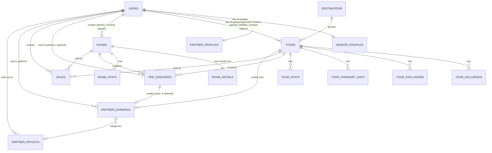
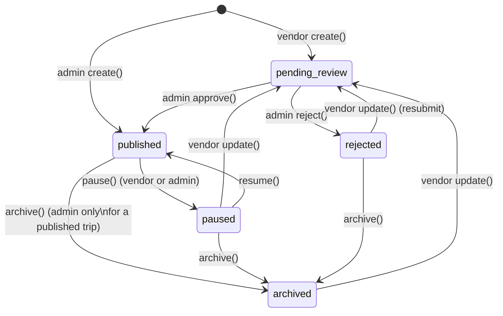
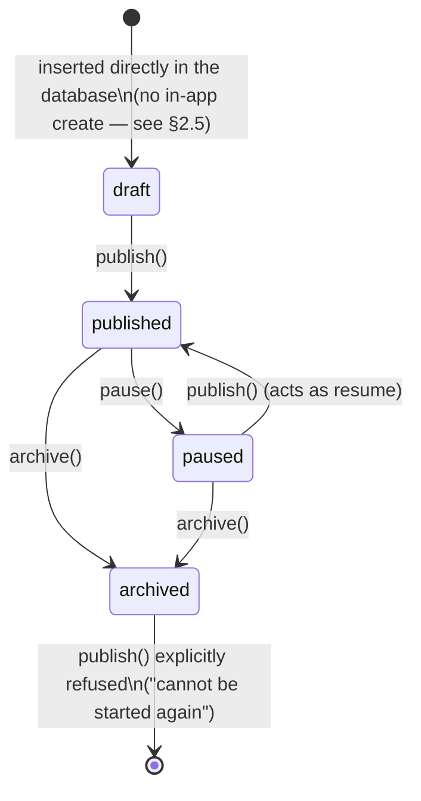
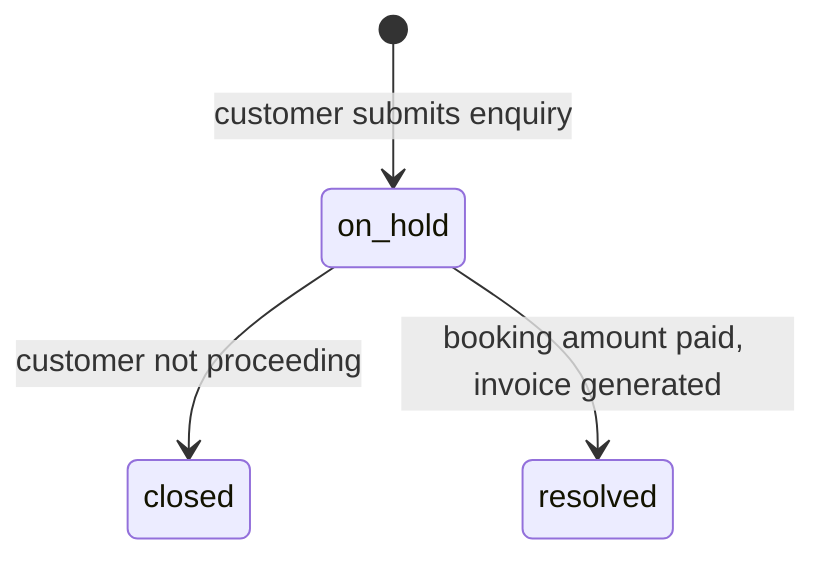
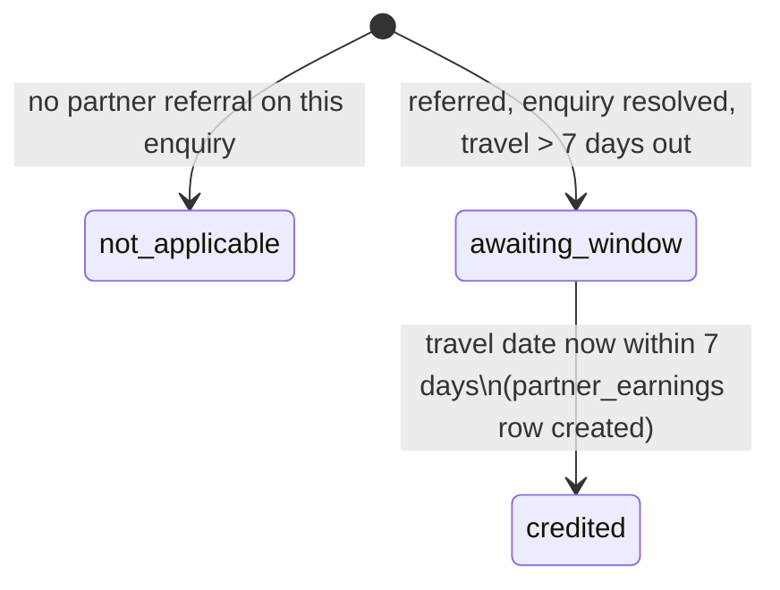
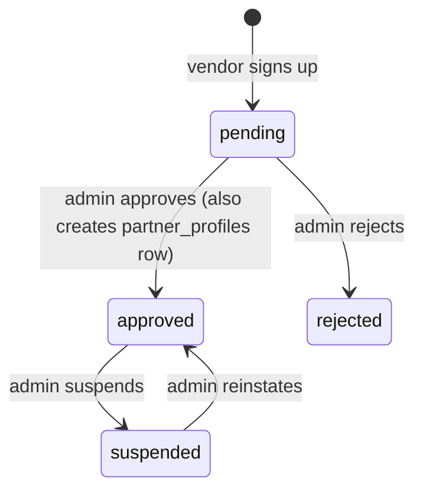

# Embark Pedia — Database Architecture (Replanned Reference)

## What this document is, and how it relates to `database/README.md`

`database/README.md` is the **historical audit trail**: a requirements-to-
schema traceability table, an endpoint-by-endpoint implementation status,
and a pre-launch checklist. It reads like a changelog, and it is one —
keep it.

This document is the **architecture reference**: a clean, domain-grouped
map of the schema as it stands today (19 tables, `database/schema.sql`),
with an ERD, the status/lifecycle state machines that the application
layer enforces, and a short set of forward-looking refinement notes. Read
this first to understand *how the database is shaped*; read
[`DB_Research.txt`](DB_Research.txt) next for a plain-language, table-by-
table walkthrough of *why each table exists and how data moves through it*;
read `database/README.md` for *what's actually been built and tested so
far*. `schema.sql` itself remains the single authoritative source of DDL —
nothing here should be treated as a replacement for it, only a guide to it.

> **Two corrections carried forward from re-auditing the current codebase
> against this document and `DB_Research.txt`:**
> 1. `database/README.md` still lists "wiring `tour-render.js` to post into
>    `trip_enquiries` directly" as outstanding future work. That has since
>    shipped — `assets/js/submit-trip-enquiry.php` writes directly into
>    `trip_enquiries` (partner-referral lookup included), and `tour-render.js`
>    calls it.
> 2. `database/README.md` also still describes ROAMS as having
>    "listing-level CRUD implemented in `organizer-roams.php`." That's no
>    longer accurate: `organizer-roams.php`'s `create`/`update` actions
>    were since deliberately disabled (HTTP 410), and the admin dashboard's
>    own empty-state copy confirms it — *"Creation is disabled from this
>    dashboard — add rows directly via the database."* A new ROAM (and its
>    `roam_details` row) is always inserted by hand directly against the
>    database today; `organizer-roams.php` only toggles an existing row's
>    `status` (publish/pause/resume/archive). See §2.5 and §3.2 below.

---

## 1. Domain map

The 19 tables fall into six domains. Arrows show the direction of a
foreign key (`A → B` means "A has a column referencing B").

```
┌─────────────────────────────┐        ┌──────────────────────────────┐
│   ACCOUNTS & IDENTITY        │        │  CATALOGUE — TRIPS (tours)    │
│                               │        │                                │
│   users ──────────────┐      │        │  destinations                  │
│     │                 │      │        │     ▲                          │
│     ├─ vendor_profiles │      │        │     │                          │
│     ├─ partner_profiles│      │        │   tours ──► users (submitter,  │
│     │                 │      │        │     │         reviewer)        │
└─────┼─────────────────┼──────┘        │     ├─ tour_inclusions         │
      │                 │               │     ├─ tour_exclusions         │
      │                 │               │     ├─ tour_itinerary_days      │
┌─────┼─────────────────┼──────┐        │     └─ tour_stays               │
│  PARTNER PROGRAM       │      │        └──────────────────────────────┘
│                        │      │
│  partner_earnings ─────┘      │        ┌──────────────────────────────┐
│     │  ▲                      │        │  CATALOGUE — ROAMS (roams)    │
│     │  └─ tours, trip_enquiries│       │                                │
│     └─ partner_payouts        │        │  roams ──► users (creator,     │
└────────────────────────────────┘       │     │        reviewer)         │
                                          │     ├─ roam_details (1:1, JSON)│
┌──────────────────────────────┐         │     └─ roam_stays              │
│  ENQUIRIES & SALES            │         └──────────────────────────────┘
│                                │
│  trip_enquiries ──► tours OR roams, users, partner_profiles              │
│  sales          ──► tours OR roams, users                                 │
└──────────────────────────────┘

┌──────────────────────────────┐
│  PUBLIC SUBMISSIONS &          │
│  ABUSE CONTROL (no FKs out)    │
│                                │
│  contact_messages               │
│  newsletter_subscribers         │
│  rate_limits                    │
└──────────────────────────────┘
```

### Entity-relationship diagram (Mermaid)



---

## 2. Domain-by-domain table reference

### 2.1 Accounts & Identity

| Table | Purpose | Key columns | Notable constraints |
|---|---|---|---|
| `users` | Every account — customer, vendor, admin, or partner, in one table | `account_type` ENUM, `account_status`, `password_hash` (bcrypt + app-level pepper), `failed_attempts`/`locked_until` | Unique `email`; index on `(account_type, account_status)` |
| `vendor_profiles` | 1:1 extension of a `vendor`-type user — org details + review state | `review_status` ENUM (`pending/approved/rejected/suspended`) | PK = FK = `users.id` (true 1:1); `ON DELETE CASCADE` |

A vendor is **not** allowed to submit/publish a TRIP merely by having an
account — every protected endpoint must check both `account_type='vendor'`
*and* `vendor_profiles.review_status='approved'`. This is enforced in
application code (`ep_require_role()` + explicit profile checks), not by
the schema — a schema-level CHECK can't express a join condition.

### 2.2 Partner program

| Table | Purpose | Key columns | Notable constraints |
|---|---|---|---|
| `partner_profiles` | 1:1 extension of a `partner`- or `vendor`-type user — referral identity + commission rate | `partner_id` (13-char public code), `profit_share_percent` | `profit_share_percent` CHECK 30.00–50.00; unique `partner_id` |
| `partner_earnings` | Append-only ledger: one row per `trip_enquiries` row ever credited | `base_amount`, `profit_share_percent_applied`, `commission_amount` — all **snapshotted** at credit time | Unique `enquiry_id` (an enquiry can be credited at most once) |
| `partner_payouts` | One row per quarterly payout run, per partner | `period_start/end`, `total_amount` | — |

The snapshot pattern in `partner_earnings` is deliberate: a later change to
`partner_profiles.profit_share_percent` must never rewrite history, so the
rate actually applied is frozen on the earning row itself. "Every vendor is
also a partner" — a `vendor_profiles.review_status` transition to
`approved` auto-creates a matching `partner_profiles` row — but a stand-
alone partner (no vendor account) is onboarded directly, so
`partner_profiles.user_id` (not `users.account_type`) is the real test for
"is this user a partner."

### 2.3 Public submissions & abuse control

| Table | Purpose | Key columns | Written by |
|---|---|---|---|
| `contact_messages` | Generic contact-us submissions | `enquiry_type` ENUM, `consent_given` | `connect.php` |
| `newsletter_subscribers` | Footer newsletter signups, double opt-in | `confirm_token`, `confirmed_at` | `subscribe.php` |
| `rate_limits` | Rolling per-IP, per-action attempt log | `ip_address`, `action`, `created_at` | every public endpoint, via `ep_rate_limit()` |

None of these three have outgoing foreign keys — they're independent
submission logs, not catalogue data. `rate_limits` is a high-churn,
short-retention table (housekeeping query is commented in `schema.sql`);
consider a scheduled cron `DELETE` rather than letting it grow unbounded.

### 2.4 Catalogue — TRIPS (`tours`)

| Table | Purpose | Key columns | Notable constraints |
|---|---|---|---|
| `destinations` | Normalized destination list (slug/name/region/image/blurb) | `slug` | Unique `slug` |
| `tours` | One TRIP (2–9 days) | `article_id`, `voyage_id`, `status` ENUM, `submitted_by_user_id`, `reviewed_by_user_id` | `days >= 2`; unique `article_id`/`voyage_id`; FK to `destinations` is `ON DELETE RESTRICT` (can't delete a destination with TRIPS) |
| `tour_inclusions` / `tour_exclusions` | Ordered bullet lists | `position`, `item_text` | Unique `(tour_id, position)`; `ON DELETE CASCADE` |
| `tour_itinerary_days` | One row per day | `day_number`, `plan_text`, `is_highlight`, `note_text` | Unique `(tour_id, day_number)` |
| `tour_stays` | Ordered lodging/check-in stops | `checkin_number`, `hotel_name`, `checkin_day`/`checkout_day` | `checkout_day >= checkin_day` when both set |

`status` lifecycle: see §3.1. `roams.status` uses the identical ENUM, but
the transitions actually reachable through the application are quite
different — see §3.2.

### 2.5 Catalogue — ROAMS (`roams`)

| Table | Purpose | Key columns | Notable constraints |
|---|---|---|---|
| `roams` | One ROAM's **listing/card** data (title, route, dates, price, status) | `slug`, `status` ENUM, `created_by_user_id` | Unique `slug` |
| `roam_details` | The **full detail page**, 9 JSON sections (hero/about/gallery/itinerary/inclusions/packing/eligibility/faq/footer) | one row per `roams.id` | PK = FK = `roams.id` (1:1); `ON DELETE CASCADE` |
| `roam_stays` | Ordered lodging/check-in stops (organizer-facing, structured) | same shape as `tour_stays` | Unique `(roam_id, checkin_number)` |

> **`roams`/`roam_details`/`roam_stays` have no INSERT path in the
> application at all.** `organizer-roams.php`'s `create`/`update` actions
> were deliberately disabled (HTTP 410) and the admin UI's own empty-state
> text says the same: every new ROAM is added by hand, directly against
> the database, by whoever has that access. `created_by_user_id` is
> therefore not populated by any current code path either (unlike
> `reviewed_by_user_id`, which *is* stamped by the `publish` action) —
> set it manually on insert if you want that provenance recorded. Only
> the four status-toggle actions (`publish`/`pause`/`resume`/`archive`)
> and the two read actions (`list`/`get`) exist on this endpoint.

`roam_details` is intentionally JSON rather than fully normalized — see §4
("Replanning notes") for the trade-off and when to revisit it. The complete
JSON field contract is documented separately in
[`roam-details-fields.txt`](roam-details-fields.txt) because it's a
UI/renderer contract (consumed by `roam-render.js`), not a relational
schema — it belongs with the other field-reference material, not duplicated
here.

### 2.6 Enquiries & sales

| Table | Purpose | Key columns | Notable constraints |
|---|---|---|---|
| `trip_enquiries` | One customer enquiry against **exactly one** TRIP or ROAM | `status` ENUM (`on_hold/closed/resolved`), `shared_with_vendor`, `partner_user_id`, `partner_credit_status` | CHECK: exactly one of `tour_id`/`roam_id` is set |
| `sales` | Manually-logged confirmed booking (no payment gateway exists yet — see §4) | `amount`, `currency`, `status` ENUM | Same one-product CHECK as above |

Both tables use the identical "exactly one of two nullable FKs" pattern
for "this row is about a TRIP *or* a ROAM, never both, never neither" —
worth keeping consistent if a third product type is ever added (a shared
`product_type` + `product_id` pair, or a dedicated `products` super-table,
would replace this pattern more scalably at that point; see §4).

---

## 3. Status lifecycles

`tours.status` and `roams.status` share one ENUM definition
(`draft`/`pending_review`/`published`/`paused`/`rejected`/`archived`) with
the same general meaning — but the transitions each table's own endpoint
actually allows differ enough that one shared diagram misrepresents one or
the other. Two diagrams below, reflecting `organizer-trips.php` and
`organizer-roams.php` exactly as written today.

### 3.1 `tours.status` (`organizer-trips.php`)



A few things worth being precise about here, since they're easy to assume
rather than verify:

- **`draft` is a valid, selectable ENUM value and the column's default,
  but no current code path ever creates or leaves a row in it.** Both
  `create()` branches (`$status = $isAdmin ? 'published' : 'pending_review'`
  in `organizer-trips.php`) skip straight past `draft`. Treat it as
  reserved for a possible future "save as draft" feature, not as an
  active state today.
- **`update()`'s effect on `status` depends entirely on who's calling it,
  not on the row's current status**: `status = IF(<is admin>, status,
  'pending_review')`. An admin's edit never changes status (whatever it
  was, it stays). A vendor's edit of any trip they're allowed to touch —
  which the same endpoint's `ep_trip_owned_editable()` permits for
  anything **except** a currently-`published` trip — always resets it to
  `pending_review`, regardless of whether it was `rejected`, `paused`, or
  even `archived` beforehand. In other words, `rejected` is **not** a dead
  end for a vendor-submitted TRIP the way the ENUM's name might suggest —
  a vendor can edit and resubmit it. Whether editing an `archived` trip
  back to life is intentional or an edge case nobody's hit yet isn't
  something the code states either way; it's simply what the guard clause
  currently allows.
- Only `status = 'published'` rows are ever returned by the
  unauthenticated `public-trips.php` endpoint — every other state is
  invisible to the public site. `paused` exists specifically so a
  published trip can come off the public site **without** losing its
  review history or child rows, unlike `archive()`, which a vendor can
  only use on their own non-published trips and an admin can use on any
  trip regardless of status.

### 3.2 `roams.status` (`organizer-roams.php`)



This is a **much** smaller state machine than the tours one above, because
`organizer-roams.php` exposes exactly four write actions in total —
`publish`, `pause`, `resume` (an alias the UI uses, but `publish` on a
paused row does the same thing server-side), and `archive` — and no
`create`/`update`/`reject` action exists at all. There is no vendor
pathway here (ROAMS have never had one) and no admin-authoring pathway
either (it existed once, per `database/README.md`'s now-outdated "listing
CRUD implemented" note, but was since removed). A new ROAM simply starts
its life at whatever `status` the direct database `INSERT` gave it —
almost always `draft` (the column default) — and the only way to change
that status afterward is through these four endpoint actions.

### 3.3 `trip_enquiries.status`



### 3.4 `trip_enquiries.partner_credit_status` (independent of the above)



This runs orthogonally to `status` — an enquiry can be `resolved` for
weeks while `partner_credit_status` stays `awaiting_window`, because the
7-day-before-travel credit rule is checked independently
(`ep_recheck_all_pending_partner_credits()` re-evaluates every pending row
on each admin page load rather than needing a cron job).

### 3.5 `vendor_profiles.review_status`



---

## 4. Replanning notes — optional, non-blocking refinements

The schema as built is sound: every table that needs one has a FK with an
explicit `ON DELETE` policy, every status/enum column is constrained,
positive-value and single-product-reference CHECKs are used consistently,
and the one-row-per-entity 1:1 extension pattern (`vendor_profiles`,
`partner_profiles`, `roam_details`) is applied correctly throughout. The
notes below are intentionally **not** "fixes" — they're trade-offs worth
revisiting only if/when their triggering condition actually arrives.

1. **`roam_details` as JSON vs. normalized child tables.** The current
   design keeps a ROAM's full detail page (hero/about/gallery/itinerary/
   inclusions/packing/eligibility/faq/footer) as nine JSON columns on one
   row, matching the shape `roam-render.js` already expects. This is the
   right call *while there's no admin UI to author that content section-
   by-section* — a JSON blob needs no migration every time a new field is
   added. **Revisit this** the moment ROAMS get a real multi-section
   authoring UI (already flagged as a gap in `database/README.md`): at that
   point, normalize `itinerary` into a table shaped like the existing
   `tour_itinerary_days`, `gallery.cards` and `faq.items` into their own
   ordered child tables with a `position` column, mirroring the pattern
   `tours` already uses. Don't normalize pre-emptively — it would add
   migration overhead for no present benefit.

2. **The "exactly one of two nullable FKs" pattern** (`trip_enquiries` and
   `sales` both reference *either* `tour_id` *or* `roam_id`). This reads
   cleanly today with two product types. If a third product type is ever
   introduced, replace it with a polymorphic pair (`product_type ENUM`,
   `product_id`) or a shared `products` parent table — repeating the
   two-nullable-column pattern a third time would make every future query
   three-way-conditional. Not worth the migration for two product types.

3. **`rate_limits` retention.** The table is write-heavy and currently has
   no automatic cleanup — `schema.sql` comments the intended cron query
   (`DELETE ... WHERE created_at < NOW() - INTERVAL 1 DAY`) but it isn't
   scheduled anywhere yet. Low risk at current scale; worth an actual cron
   entry before traffic grows significantly, since the index is on
   `(ip_address, action, created_at)` and an ever-growing table slowly
   degrades that index's usefulness.

4. **Newsletter confirmation is schema-ready but not wired.**
   `newsletter_subscribers.confirm_token`/`confirmed_at` exist and are
   populated, but no endpoint consumes the token and no mail provider is
   connected (both `database/README.md` and this file agree on this one —
   it's a genuine, not a stylistic, gap). Treat every row as an
   unconfirmed lead list, not a mailing list, until a confirmation endpoint
   and a transactional-email provider are both in place.

5. **`sales` is a manual ledger, not a checkout flow** (no `bookings` /
   `payments` tables exist yet, by design — see `schema.sql` §9). If a real
   payment gateway is ever integrated, `sales` is the natural audit-log
   target for a successful payment webhook, but the manual-entry UI and
   any future automated-entry path should write to the same table rather
   than forking the data model.

6. **Denormalized snapshot columns are intentional, not drift risk.**
   `partner_earnings.voyage_id`/`tour_title` and
   `partner_earnings.base_amount`/`profit_share_percent_applied` are
   deliberately copied at credit time so a later edit to `tours` or
   `partner_profiles` can never silently rewrite historical earnings. Keep
   this pattern if extending the earnings/payout model further — resist
   the instinct to "normalize away" a snapshot column here.

7. **The `roams` listing row itself has no in-app INSERT path, not just
   `roam_details`.** Item 1 above covers the JSON detail content; this is
   the narrower, separate point that even the lightweight `roams` row
   (title/route/dates/price/status) can't be created or edited through
   `organizer-roams.php` either — its `create`/`update` actions return
   HTTP 410 on purpose. Today that means every new ROAM — both the listing
   row and its detail JSON — is added by a direct database `INSERT`, by
   whoever has that access, with no audit trail beyond whatever that
   person's own tooling provides. If self-service ROAM publishing for
   admins becomes a priority, rebuilding `create`/`update` here (ideally
   alongside the `roam_details` authoring UI from item 1, so the two ship
   together rather than leaving one lightweight form in front of a schema
   with no way to fill in the content behind it) is the natural next step.

None of the above blocks a production launch on their own; `database/
README.md`'s "Install and production cautions" section (least-privilege DB
grants, pepper rotation, newsletter/consent follow-through, rate-limit
cleanup) remains the actual pre-launch checklist.

---

## 5. Indexing rationale (quick reference)

| Index | On | Why |
|---|---|---|
| `uq_users_email` | `users(email)` | Login lookup + uniqueness |
| `idx_users_type_status` | `users(account_type, account_status)` | Every `ep_require_role()` check filters on both |
| `idx_tours_destination_status` | `tours(destination_id, status)` | Public catalogue query groups by destination, filters `published` |
| `idx_trip_enquiries_status_created` | `trip_enquiries(status, created_at)` | Admin queue is always "open enquiries, newest first" |
| `idx_trip_enquiries_partner_credit` | `trip_enquiries(partner_user_id, partner_credit_status)` | The pending-credit recheck scans exactly this slice |
| `idx_partner_earnings_partner_payout` | `partner_earnings(partner_user_id, payout_id)` | Dashboard's "pending vs. paid" split is a `payout_id IS NULL` filter on this |
| `idx_rate_limits_lookup` | `rate_limits(ip_address, action, created_at)` | Matches the exact `WHERE` clause in `ep_rate_limit()` |

---

## 6. See also

- [`database/schema.sql`](schema.sql) — authoritative DDL for everything above.
- [`database/DB_Research.txt`](DB_Research.txt) — plain-language, per-table
  use-case and data-movement walkthrough, plus full user-journey traces.
- [`database/README.md`](README.md) — implementation status and pre-launch checklist.
- [`database/roam-details-fields.txt`](roam-details-fields.txt) — the
  `roam_details` JSON field contract.
